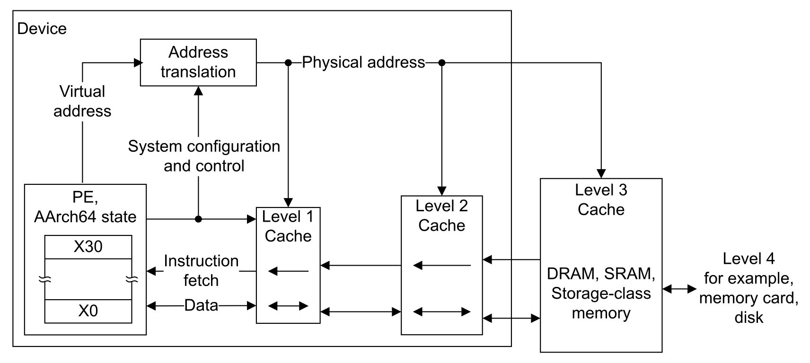

# Zircon Memory: Physmap, TTBR, PMM, and Walks

Stop when a user load has a PA.

## When to use

* Editing `ArmArchVmAspace`, physboot address space, or kernel.ld layout.
* A translation fault / `FAR_EL1` that is not a missing user mapping policy.
* Changing PMM arenas, `vm_page` state, kernel heap, VMO/VMAR
  allocation, demand paging, cache coherency, or ASIDs.

## When not to use

* The fault *handler* and ESR decode — `interrupt.md`.
* Context switch of `TTBR0` — `cpu.md`.
* Per-instruction cache ops and PoU/PoC names in isolation — `cpu.md`
  **Cache**. This file owns when the VM issues those ops.

> [!NOTE]
> Console image: Zircon kernel + linux-arm64-boot-shim + BOOTFS + serial
> console + `zxsh`. The kernel is an EL2 VHE host.

## Map of this note

| §§ | Topic |
| --- | --- |
| 1–12 | Hardware: PA, VA, TTBR, PTE, how a mapping is installed |
| 13–15 | PMM page (one `vm_page` per 4 KiB), PageCache, heap / VMO allocators |
| 16 | Page fault: VM finds a mapping and fills the PTE |
| 17 | Cache coherency: D-cache, I-cache, walker/TLB, devices |
| 18 | Object graph: handle → VMAR / VMO → PTE |
| 19 | User process aspace: userboot, `zxsh`, create / destroy |
| 20 | Syscalls: `zx_vmo_*` / `zx_vmar_*` on the console path |
| 21 | Unmap, protect, destroy |
| 22 | ASID |

Pager-backed VMOs, compression, loaned pages, and shared/restricted
aspaces exist in the tree. They are not on the `zxsh` path.

## 1. Framework

Physical RAM and MMIO on the left; two translation regimes and the
registers that walk them on the right.

```text
┌────────────┐ ┌────────────┐ ┌────────────┐ ┌────────────────────┐
│ flash      │ │ GICv3      │ │ PL011 UART │ │ DRAM               │
│ 0x00000000 │ │ 0x08000000 │ │ 0x09000000 │ │ 0x40000000         │
└────────────┘ └────────────┘ └────────────┘ └─────────┬──────────┘
       device MMIO on demand                           │ PMM
                                                       ▼
                              physmap VA = KERNEL_ASPACE_BASE + PA
                              0x40000000 → 0xffff000040000000

┌───────────────────────────────┬──────────────────────────────────┐
│ TTBR0_EL1  user  VA[55]=0     │ TTBR1_EL1  kernel  VA[55]=1      │
│ USER_ASPACE  0x200000         │ KERNEL_ASPACE  0xffff000000000000│
│ zx_vmar_map → VmMapping       │ physmap, kernel image, heap      │
│ L0 → L1 → L2 → L3  (4 KiB)    │ shared L0, ASID 1, nG=0          │
└───────────────────────────────┴──────────────────────────────────┘

  MAIR_EL1     TCR_EL1      TTBR0_EL1     TTBR1_EL1     SCTLR_EL1
  AttrIndx     T0SZ/T1SZ=16  user L0+ASID  kernel L0     M / C / I
```

Software objects that own those tables (**Object graph**):

```text
 ProcessDispatcher
    ShareableProcessState
       HandleTable          VmAspace (user TTBR0 + ASID)
                               Root VMAR
                                  sub-VMAR (ELF, stack, …)
                                     VmMapping ──► VmObject (paged / physical)
                                                      vm_page[] in PMM
                               ArmArchVmAspace  L0…L3
```

## 2. Flow

Physboot turns the MMU on; the kernel reuses those tables, then the VM
installs later maps.

```text
┌─────────────────┐
│ boot-shim       │  MMU off, DTB in x0
│ linux-arm64     │  RAM / UART / GIC → ZBI items
└────────┬────────┘
         ▼
┌─────────────────┐
│ physboot        │  MAIR + identity-map RAM/UART (TTBR0)
│                 │  SCTLR.M/C/I on
│                 │  kernel ELF at 0xffffffff00000000 (TTBR1)
│                 │  physmap + hand-off + image
└────────┬────────┘
         ▼
┌─────────────────┐
│ kernel EL2 VHE  │  arm64_mmu_early_init reads TTBR0/TTBR1
│                 │  reuse TTBR1 root, ASID 1
│                 │  PMM owns RAM; tables → vm_page_state::MMU
└────────┬────────┘
         │
    ┌────┴────┐
    ▼         ▼
 user       kernel
 zx_vmar_map   heap / MMIO / stacks
    │         │
    └────┬────┘
         ▼
┌─────────────────┐
│ ArmArchVmAspace │  Map / Query / ContextSwitch
│ ::Map           │  L0–L3 walk, tlbi, dc cvau + ic ialluis if X
└────────┬────────┘
         ▼
    hardware walk
    TTBR0 or TTBR1 → PA
```

## 3. Overall layout on QEMU virt

Two pictures. First is the **physical** map firmware and lkboot
place. Second is the same DRAM after physboot turns the MMU on.
Sequence is [`bootstrap.md`](bootstrap.md); this section is the
addresses.

```text
 PA  (qemu-system-aarch64  virt,  -m 1024,  -s 8,  --gic=3,  secure=on)
 0x00000000 ┬ flash / secular.bios     BL1 + FIP (BL31 / Trusty / lkboot)
 0x08000000 ├ GICv3 GICD
 0x080A0000 ├ GICv3 GICR      × NCPU
 0x09000000 ├ PL011 UART
 0x09020000 ├ fw_cfg          -kernel / -initrd selectors
 0x0e000000 ├ secure SRAM     ATF BL1 RW / BL2 / BL31
 0x0e100000 ├ secure DRAM     Trusty BL32
            │
 0x40000000 ▼ DRAM  1 GiB
            │  ┌──────────────────────────────────────────────────────────┐
            │  │ 0x40000000  DTB           x0; ATF-patched                │
            │  ├──────────────────────────────────────────────────────────┤
            │  │ 0x40200000  Image         linux-arm64-boot-shim (lkboot) │
            │  ├──────────────────────────────────────────────────────────┤
            │  │ 0x44000000  initrd ZBI    secular.zbi, 4 KiB padded      │
            │  │               last page = kDataZbi only                  │
            │  ├──────────────────────────────────────────────────────────┤
            │  │ 0x60000000  lkboot BL33   dead after chain-load → PMM    │
            │  ├──────────────────────────────────────────────────────────┤
            │  │ free RAM      memalloc kFreeRam → PMM after handoff      │
            │  └──────────────────────────────────────────────────────────┘
 0x80000000   DRAM end (default 1 GiB)
```

Firmware-placed occupants on virt (QEMU, 1 GiB). QEMU `-kernel` /
`-initrd` feed fw_cfg; lkboot copies them here. QEMU may also dump the
Image at `DRAM+0x80000`; the boot path ignores that copy.

| Occupant | PA | Size rule |
| --- | --- | --- |
| DTB | `0x40000000` | FDT blob; `x0`; 1 MiB window |
| Image (shim) | `0x40200000` | lkboot copy; 16 MiB max |
| initrd (ZBI) | `0x44000000` | lkboot copy; **4 KiB padded** |
| lkboot BL33 | `0x60000000` | FIP payload; reclaimable after jump |
| free RAM | rest | `[0x40000000, 0x80000000)` minus the above |

Device MMIO is **not** DRAM. The kernel maps GIC / UART only where a
driver or the UART path needs them. RAM is tracked by phys `memalloc`
from DTB memory nodes plus special ranges (shim, DTB, initrd), then
handed to PMM.

#### Last page of the initrd

`BootZbi::Init` calls `Allocation::Adopt` on the ramdisk. The start
address must be page-aligned. The length used to be the raw ZBI file
size (`secular.zbi` was 6083 pages + 1128 bytes). Adopt then tries to
**extend** the allocation to the end of that last page so later
in-place `Load()` / `Append()` cannot share the page with a neighbour.

That extend asks `memalloc` for the leftover bytes as `kFreeRam`. It
fails — and prints `Adopted allocation cannot be extended to page
boundary` — when those bytes are already something else:

```text
                    one 4 KiB page
         ├────────────── kDataZbi ──────────┬── neighbour ───┤
         │  … ZBI bytes (1128 in last page) │ DTB /          │
         │                                  │ memreserve /   │
         │                                  │ bookkeeping    │
         └──────────────────────────────────┴────────────────┘
                                            ▲
                                            Adopt::Extend fails here
```

The product pads `secular.zbi` to 4 KiB (`pad_to_page` on
`//products/secular:secular`). QEMU's `linux,initrd-end` is then a
page boundary. Adopt sees `size % 4096 == 0` and does not extend.
The container header is unchanged; the extra zeros are only file tail,
and they become spare storage in the ramdisk span.

```text
         ├────────────── kDataZbi (whole pages) ─────────────┤
         │  ZBI container          │ zero pad to 4 KiB       │
         └─────────────────────────┴─────────────────────────┘
         ▲ page                    ▲ page                    ▲ page
```

#### Same DRAM after the MMU is on

Physboot identity-maps RAM, then publishes it as the kernel **physmap**.
On QEMU virt, `paddr_to_physmap(0x40000000)` is `0xffff000040000000`.

```text
 PA 0x40000000  DRAM
      │
      │  physmap   VA = KERNEL_ASPACE_BASE + PA     TTBR1
      │            0x40000000  →  0xffff000040000000
      │
      ├─ kernel ELF image      VA 0xffffffff00000000   TTBR1
      ├─ hand-off / heap       TTBR1, not linear
      ├─ userboot / zxsh       some user VA            TTBR0 of that process
      └─ UART 0x09000000       a kernel device VA      TTBR1, AttrIndx 1
```

## 4. Virtual address space

ARM EL1&0 (VHE: EL2&0 with EL1-named TTBRs) uses two translation
regimes. VA bit 55 (equivalently VA[63:48]
all-zero vs all-one for a 48-bit VA) selects the root:

```text
┌────────────────────────────────────────────────────────────────┐
│ 0x0000_0000_0000_0000   unused (2 MiB low guard)               │
│ 0x0000_0000_0020_0000   USER_ASPACE_BASE     TTBR0_EL1  (user) │
│         …  user VA, 48-bit half minus guards …                 │
│ 0x0000_ffff_ff00_0000   USER_ASPACE end (16 MiB high guard)    │
├────────────────────────────────────────────────────────────────┤
│ 0xffff_0000_0000_0000   KERNEL_ASPACE_BASE   TTBR1_EL1 (kernel)│
│         physmap  [0, last RAM)  linearly mapped                │
│         hand-off data                                          │
│         kernel image at kHandoffVirtualAddress                 │
│         heap / first-class kernel mappings                     │
│ 0xffff_ffff_ffff_ffff   last kernel byte                       │
└────────────────────────────────────────────────────────────────┘
```

Constants live in [`zircon/kernel/arch/arm64/include/arch/kernel_aspace.h`](../../../zircon/kernel/arch/arm64/include/arch/kernel_aspace.h):

| Symbol | Value | Meaning |
| --- | --- | --- |
| `KERNEL_ASPACE_BASE` | `0xffff000000000000` | kernel VA start; TTBR1 |
| `KERNEL_ASPACE_SIZE` | `2^48` | 256 TiB kernel half |
| `USER_ASPACE_BASE` | `0x200000` | 2 MiB low guard |
| `USER_ASPACE_SIZE` | `0xffffff000000 - 2 MiB` | user half under 48-bit VA |
| `kHandoffVirtualAddress` | `0xffffffff00000000` | kernel ELF load VA |

`is_user_accessible(va)` is “bit 55 is 0”. `is_kernel_address(va)` is “inside
`[KERNEL_ASPACE_BASE, KERNEL_ASPACE_BASE + KERNEL_ASPACE_SIZE)`”. User PCs
must be user-accessible and not in the kernel window
([`zircon/kernel/arch/arm64/include/arch/vm.h`](../../../zircon/kernel/arch/arm64/include/arch/vm.h)).

User VA also enables TBI0 (top-byte ignore): bits [63:56] are not part of
the translation. `arch_detag_ptr` strips them.

The two halves are **separate trees**, not one table with a kernel
high-half. How they share RAM is **User and kernel page tables** and
**Memory relationship**. How a load becomes a PA is **Translation
flow**.

## 5. User and kernel page tables

EL1&0 stage-1 always has two roots. `VA[55]` picks which one the
hardware walks. There is no combined L0.

```text
                    PE  EL1 (and EL0 of the current user thread)
                              VA[55]
                     ┌──────────┴──────────┐
                     │ 0                   │ 1
                     ▼                     ▼
              TTBR0_EL1               TTBR1_EL1
              user L0                 kernel L0
              ASID ≥ 2                ASID 1, nG=0 (global)
              per process             one for the whole system
              swapped on sched        never swapped
              TCR.EPD0 = 0            always walked
                when a user thread
                is current
```

| | User (`TTBR0`) | Kernel (`TTBR1`) |
| --- | --- | --- |
| Object | one `VmAspace` per process | the kernel `VmAspace` |
| L0 page | allocated in `ArmArchVmAspace::Init` | physboot's upper root, reused |
| Who sees it | that process's threads (EL0 and EL1) | every PE, every thread |
| Context switch | `TTBR0 = ASID\|tt_phys`, `TCR` user | left alone |
| Idle / DPC / boot | `TCR.EPD0=1`: TTBR0 walks **off** | still on |
| PTE `nG` | 1 (ASID-tagged TLB) | 0 (global TLB) |
| Mapped by | `zx_vmar_map` → `VmMapping` | physmap, image, heap, MMIO, kstacks |

They do **not** share table pages. A user L3 PTE and a kernel L3 PTE
may point at the **same PA** (a VMO page that is also in the physmap).
The kernel writes user PTEs through the physmap: `tt_virt_ =
paddr_to_physmap(tt_phys_)`. EL0 may issue a kernel VA (`VA[55]=1`);
the walk uses TTBR1, then AP/UXN on the kernel PTE deny it (permission
fault, not a different root).

While a **user** thread is current, both roots are live:

```text
EL0  load [user VA]     walk TTBR0
EL0  load [kernel VA]   walk TTBR1, then AP/UXN deny
EL1  load [kernel VA]   walk TTBR1 (physmap, heap, UART)
EL1  copy_from_user     walk TTBR0 (same aspace, still this Thread)
```

`copy_from_user` does not switch tables. The syscall is the same
`Thread*`, `TTBR0` still names that process (`cpu.md`). A kernel-only
thread has `EPD0`, so a stray user VA in idle is a translation fault,
not a walk of some leftover process.

Restricted / shared aspaces (`ZX_PROCESS_SHARED`) split TTBR0 further.
The console image does not: userboot, component_manager, and `zxsh`
each have one user L0.

## 6. Memory relationship

Physical DRAM is one pool. Virtual windows are many. PMM owns the
pages; aspaces only install PTEs. How the PMM tracks those pages,
who allocates them, and how the CPU cache is kept consistent is
**Kernel memory management** through **Cache coherency**. The
handle/VMAR/VMO objects are **Object graph**.

```text
 DRAM  0x40000000…          MMIO  GIC 0x08000000  UART 0x09000000
        │ PMM                      │ mapped on demand, not in physmap
        ▼
  vm_page  (FREE / ALLOC / MMU / …)
        │
        ├──────────────────┬──────────────────┐
        ▼                  ▼                  ▼
 kernel physmap      kernel image/heap    user VMO
 VA = BASE + PA      TTBR1, not linear    VmObject pages
 TTBR1, nG=0         kstack, arena        │
                                          ▼
                                   zx_vmar_map  (per process)
                                   TTBR0, nG=1, that ASID
```

Same physical page, two (or more) VAs:

| View | VA | Table | Who |
| --- | --- | --- | --- |
| Physmap | `0xffff000000000000 + PA` | kernel L3 (or L1/L2 block) | kernel, all CPUs |
| User mapping | whatever the VMAR chose | that process's L3 | EL0 of that process; EL1 `copy_*_user` |
| Another process | a different user VA | a different TTBR0 | only that process |

The kernel does **not** put user mappings into TTBR1. It looks at user
memory either by walking TTBR0 (`copy_from_user`) or by the physmap
alias of a page it already owns (fault handler, `Map` of a VMO page).
Page-table pages themselves are PMM pages in state `MMU`; the CPU and
the kernel both reach them as `paddr_to_physmap(table_pa)`.

MMIO (GIC, UART) is a hole in the physmap span: those PAs are not RAM,
so they are not in the linear window. Drivers map them `UNCACHED_DEVICE`
in the kernel aspace only.

Console boot, one picture:

```text
PA 0x40000000…     DRAM
  kernel image     →  VA 0xffffffff00000000     TTBR1
  physmap          →  VA 0xffff000040000000     TTBR1  (same PAs)
  userboot ELF     →  some user VA              TTBR0 of "userboot"
  zxsh text/stack  →  other user VAs            TTBR0 of zxsh
  UART 0x09000000  →  a kernel device VA        TTBR1, AttrIndx 1
```

`zxsh` and userboot never see each other's TTBR0. Both see nothing of
the kernel half. The kernel sees every process's user half only while
that process's thread is current (or via an explicit aspace switch).

## 7. Translation flow

A load, store, or fetch at `VA` on this PE:

```text
 CPU issues access at VA, current EL, read/write/execute
        │
        ▼
 TLB lookup   (ASID from TTBR0, or global if nG=0)
        │ hit: PA + attrs, apply AP/UXN/PXN vs EL → done
        ▼ miss
 VA[55]
   │ 0                    │ 1
   ▼                      ▼
 TTBR0.BADDR             TTBR1.BADDR
 (EPD0? → fault)         kernel L0
 user L0
        │
        ▼
 L0[(VA>>39)&0x1ff]  table?
 L1[(VA>>30)&0x1ff]  table or 1 GiB block?
 L2[(VA>>21)&0x1ff]  table or 2 MiB block?
 L3[(VA>>12)&0x1ff]  4 KiB page?
        │
        ├─ Valid=0 / AF=0 / AP or UXN/PXN deny
        │     → SYNC abort  (interrupt.md page fault)
        ▼
 PA = OA + VA[11:0]     (or + block offset)
 AttrIndx → MAIR_EL1    cache / device
        │
        ▼
 access the cache or the device at PA
```

Software does the same walk as `QueryLocked` (via physmap of each
table). `AT S1E0R/W` / `AT S1E1R/W` asks the MMU and reads `PAR_EL1`.

EL0 vs EL1 on the **same** PTE:

| Access | EL0 | EL1 |
| --- | --- | --- |
| User page, AP=`01` (RW/RW) | allowed | allowed (`copy_*_user`) |
| User text, UXN=0, PXN=1 | fetch ok | EL1 must not execute user |
| Kernel page, AP=`00` (RW/none) | fault | allowed |
| Kernel text, UXN=1 | EL0 cannot fetch | EL1 fetch ok |

A process switch is only a `TTBR0` (and maybe `TCR`) write
(`ArmArchVmAspace::ContextSwitch`). The walk above then starts from a
different L0. `TTBR1` and the kernel TLB entries (global) stay.

Failed walks are `ESR` instruction/data abort, `FAR` = VA. Recoverable
translation / AF / permission faults go to `vmm_page_fault_handler`
([`interrupt.md`](interrupt.md) for the abort, **Page fault** here for
the VM fill).

## 8. How mapping is completed

There are two phases. Physboot builds the first tables and turns the MMU on.
The kernel then takes those tables over and maps everything else through the
VM.

```text
┌────────────────────────────────────────────────────────────────┐
│ boot-shim (MMU off)                                            │
│   DTB in x0, RAM / UART / GIC as ZBI items                     │
└────────────────────────────┬───────────────────────────────────┘
                             ▼
┌────────────────────────────────────────────────────────────────┐
│ physboot                                                       │
│   ArchSetUpAddressSpace                                        │
│     MAIR + identity-map RAM and UART (TTBR0)                   │
│     enable SCTLR.M/C/I                                         │
│   load kernel ELF at 0xffff_ffff_0000_0000 (TTBR1)             │
│   map physmap, hand-off, kernel image                          │
└────────────────────────────┬───────────────────────────────────┘
                             ▼
┌────────────────────────────────────────────────────────────────┐
│ kernel EL2 VHE                                                 │
│   arm64_mmu_early_init reads TTBR0/TTBR1                       │
│   PMM owns RAM; page-table pages become vm_page_state::MMU     │
│   VmAspace + ArmArchVmAspace::Map install later mappings       │
└────────────────────────────┬───────────────────────────────────┘
                             ▼
┌────────────────────────────────────────────────────────────────┐
│ user process                                                   │
│   zx_vmar_map → VmMapping → ArmArchVmAspace::Map → TTBR0 walk  │
└────────────────────────────────────────────────────────────────┘
```

#### 1. Physboot identity map

Entry ([`zircon/kernel/arch/arm64/phys/start.S`](../../../zircon/kernel/arch/arm64/phys/start.S)) assumes caches and MMU are
off. After stacks exist, `ArchSetUpAddressSpace`
([`zircon/kernel/arch/arm64/phys/address-space.cc`](../../../zircon/kernel/arch/arm64/phys/address-space.cc)) does:

1. Program MAIR with the four attributes the kernel also uses (must stay in
   sync with `mmu.h`).
2. Allocate a lower root (TTBR0) and an upper root (TTBR1).
3. Identity-map all RAM as RWX normal memory, and the UART page as device
   memory.
4. Write MAIR, TCR, TTBR0, TTBR1; then set `SCTLR_ELx.M/C/I`.

Paging config is `4k-48bit` ([`zircon/kernel/lib/page/BUILD.gn`](../../../zircon/kernel/lib/page/BUILD.gn)). Identity
maps prefer 1 GiB, then 2 MiB, then 4 KiB blocks
(`kAddressSpacePageSizeShifts` in `phys/include/phys/address-space.h`).

#### 2. Kernel virtual map in physboot

Before jumping into `vmzircon`, physboot constructs the kernel aspace
([`zircon/kernel/phys/handoff-prep-vm.cc`](../../../zircon/kernel/phys/handoff-prep-vm.cc)):

```text
KERNEL_ASPACE_BASE + KERNEL_ASPACE_SIZE
        first-class kernel mappings          (bump up)
        hole (1 page)
        kernel memory image                  load VA 0xffffffff00000000
        hole (1 page)
        permanent hand-off data              (bump down)
        temporary hand-off data              (bump down, 1 GiB below image)
KERNEL_ASPACE_BASE + PhysmapSize()
        physmap: PA [0, last RAM) → VA [base, base + size)
KERNEL_ASPACE_BASE
```

The physmap is a linear window: `va = gPhysmapBase + pa`,
`pa = va - gPhysmapBase` ([`zircon/kernel/vm/include/vm/physmap.h`](../../../zircon/kernel/vm/include/vm/physmap.h)).
Non-RAM holes inside that span (flash, GIC, reserved firmware) are not
mapped even when they sit below `gPhysmapSize`. After this point the kernel
dereferences physical pages through the physmap: page tables themselves are
written via `paddr_to_physmap(table_paddr)`.

#### 3. Kernel takeover

`arm64_mmu_early_init` ([`zircon/kernel/arch/arm64/mmu.cc`](../../../zircon/kernel/arch/arm64/mmu.cc)) snapshots:

```text
root_lower_page_table_phys  ← TTBR0_EL1.BADDR
root_kernel_page_table_phys ← TTBR1_EL1.BADDR
```

`ArmArchVmAspace::Init` for the kernel aspace does **not** allocate a new
root. It reuses `root_kernel_page_table_phys`, ASID 1 (`MMU_ARM64_GLOBAL_ASID`).
PMM then marks physboot's table pages `vm_page_state::MMU` and stamps a
software parity bit on every PTE (`HandoffPageTablesFromPhysboot`).

Secondary CPUs ([`zircon/kernel/arch/arm64/secondary.S`](../../../zircon/kernel/arch/arm64/secondary.S)) program the same
MAIR/TCR/TTBRs, enable `SCTLR_EL1.M`, jump to the kernel virtual address,
then switch TCR to `MMU_TCR_FLAGS_KERNEL` so TTBR0 walks are disabled until
a user aspace is installed.

#### 4. Runtime maps (kernel VM)

After `vm_init`, new mappings go through the VM, not through physboot:

```text
VmObject (VMO)          pages of content (anonymous, physical, pager)
    │
VmAddressRegion (VMAR)  VA range that may contain mappings
    │
VmMapping               (vaddr, size, VMO offset, mmu flags)
    │
ArmArchVmAspace::Map    install PTEs in this aspace's tables
```

A user `zx_vmar_map` allocates a spot in the process VMAR, creates a
`VmMapping`, and on first access (or when populated) calls
`ArmArchVmAspace::Map(vaddr, phys[], count, flags)`. Kernel callers do the
same on the kernel `VmAspace` (heap, MMIO, stacks).

`Map` / `MapContiguous`:

1. Reject unaligned VA/PA, missing `PERM_READ`, or execute+uncached.
2. Translate `arch_mmu_flags_t` into PTE attributes (`MmuParamsFromFlags`).
3. If the mapping is executable, clean D-cache (physmap alias) so I-cache
   sees the new bytes.
4. Walk/allocate tables with `MapPageTable`, installing L1/L2 **blocks**
   (1 GiB / 2 MiB) when VA, PA, and size are aligned, otherwise L3 **pages**.
5. TLB maintenance through `ConsistencyManager` (`tlbi` + `dsb` + `isb`).

Unmap/protect may split a block (`SplitLargePage`). ARM requires
break-before-make when the block size changes; that is enabled only after
`LK_INIT_LEVEL_VM` so early physmap surgery can still rewrite large blocks.

Context switch (`ArmArchVmAspace::ContextSwitch`) writes:

| Incoming aspace | `TTBR0_EL1` | `TCR_EL1` |
| --- | --- | --- |
| user | `ASID << 48 \| tt_phys` | `MMU_TCR_FLAGS_USER` (TBI0, both halves) |
| kernel-only (`nullptr`) | `0` | `MMU_TCR_FLAGS_KERNEL` (`EPD0`: no TTBR0 walks) |

`TTBR1_EL1` stays the kernel root + global ASID for the life of the CPU.

## 9. Page table establishment


Granule is 4 KiB. Each table is one page: 512 × 8-byte PTEs
(`MMU_*_PAGE_TABLE_ENTRIES = 1 << (12 - 3)`). Four levels, 9 index bits
each, 48-bit IA:

```text
VA bit:  47……39  38……30  29……21  20……12  11…………0
         L0 idx  L1 idx  L2 idx  L3 idx  page offset
         512 GB  1 GB    2 MB    4 KB
```

Index shift for level `n` is `MMU_LX_X(12, n) = (4 - n) * 9 + 3`:

| Level | `index_shift` | Descriptor if terminal | Block size |
| --- | --- | --- | --- |
| L0 | 39 | table only (no 512 GiB blocks) | — |
| L1 | 30 | block (`0b01`) or table (`0b11`) | 1 GiB |
| L2 | 21 | block or table | 2 MiB |
| L3 | 12 | page (`0b11`) | 4 KiB |


`MMU_PTE_DESCRIPTOR_BLOCK_MAX_SHIFT` is 30, so L0 never holds a block.

Kernel and user aspaces both start at L0 (`MMU_KERNEL_TOP_SHIFT` /
`MMU_USER_TOP_SHIFT` = 39) because each half is 48 bits. Guest stage-2
(hypervisor IPA) is 36-bit and starts at L1; Secular's console image does
not need it.

#### Building a tree

`ArmArchVmAspace::Init` for a **user** aspace:

1. Allocate one PMM page, zero it (`arch_zero_page` / `dc zva`), `dsb ishst`.
2. That page is the L0 root; `tt_phys_` is its PA, `tt_virt_` its physmap VA.
3. Allocate an ASID if `arm64_enable_asid` is on **and** the CPU has 16-bit
   ASIDs. 8-bit ASIDs are ignored; TLBs are flushed on every switch instead.

`MapPageTable` (recursive):

```text
at this level, for each PTE index covered by the cursor:
  if VA/PA not aligned to this block size, or remaining size too small,
     or shift > 30:
        if PTE invalid: alloc next-level table, zero it, store table descriptor
        recurse into that table
  else:
        write a block (L1/L2) or page (L3) PTE: PA | attrs | descriptor
```

A table descriptor is `next_table_pa | MMU_PTE_L012_DESCRIPTOR_TABLE`. New
tables are published with a store-release so concurrent software walkers
(`MarkAccessed`) see zeroes, not stale data. Hardware walkers are ordered
with `dsb ishst` before the parent PTE is made valid.

Kernel root is shared by every CPU. User roots are per `VmAspace`. PTEs
carry a software odd-parity bit (`MMU_PTE_RES_PARITY`, bit 56) checked on
every load; mismatch panics.

## 10. Page table translation

End-to-end (TLB, `VA[55]`, EL0 vs EL1 permissions) is **Translation
flow**. This subsection is the table walk itself.

Hardware walk (EL1&0 stage 1), matching `QueryLocked`:

```text
if VA[55] == 0:  root = TTBR0_EL1.BADDR,  va' = VA            # user
else:            root = TTBR1_EL1.BADDR,  va' = VA - vaddr_base  # kernel
                                                 # vaddr_base = 0xffff000000000000

table = root
for shift in 39, 30, 21, 12:
    index = (va' >> shift) & 0x1ff
    pte   = table[index]
    if pte.Valid == 0:  fault
    if pte is block (L1/L2) or page (L3):
        PA = pte.OA + (VA & (block_size - 1))
        apply AP / UXN / PXN / AttrIndx; done
    table = physmap(pte.OA)          # next-level table
```

`ArmArchVmAspace::Query` is that walk in software. `arm64_mmu_translate`
asks the CPU instead:

```text
AT S1E0R/W, va     # user read/write
AT S1E1R/W, va     # kernel read/write
ISB
PAR_EL1            # bit 0 = fault; PA in bits [51:12]
```

TLB: successful walks cache in the TLB tagged by ASID (user) or as global
(kernel, `nG=0`). After a PTE change the consistency manager issues
`TLBI VAE1IS` / `VALE1IS` (user+ASID), `VAAE1IS` / `VAALE1IS` (all ASIDs),
or `VMALLE1IS` (whole EL1), then `DSB ISH` and `ISB`.

A translation fault becomes a synchronous exception: `ESR_EL1` class
`IABT`/`DABT`, `FAR_EL1` holds the VA. The VM fault path looks up the
`VmMapping`, may demand-page the VMO, then `Map`s the page and retries.

## 11. PTE bits

64-bit descriptor ([`zircon/kernel/arch/arm64/include/arch/arm64/mmu.h`](../../../zircon/kernel/arch/arm64/include/arch/arm64/mmu.h)):

| Bits | Field | Role |
| --- | --- | --- |
| [0] | Valid | 0 = invalid (must be the whole PTE 0 here) |
| [1:0] | Descriptor | L0–L2: `01` block, `11` table; L3: `11` page |
| [4:2] | AttrIndx | MAIR index 0–3 |
| [5] | NS | non-secure |
| [7:6] | AP | EL1/EL0 read-write vs read-only |
| [9:8] | SH | shareability (inner shareable for RAM) |
| [10] | AF | access flag; kernel sets it on new maps |
| [11] | nG | not-global; user pages, ASID-tagged |
| [47:12] | OA | output address (PA or next table) |
| [52] | Contiguous | hint for 16-entry blocks |
| [53] | PXN | privileged execute never |
| [54] | UXN | unprivileged execute never |
| [55] | sw AF | software accessed bit on **table** entries |
| [56] | parity | software odd parity |

Stage-1 AP encodings used here:

| AP | EL1 | EL0 |
| --- | --- | --- |
| `00` | RW | none | kernel data |
| `10` | RO | none | kernel RO / text after lockdown |
| `01` | RW | RW | user writable |
| `11` | RO | RO | user readable / executable |

Kernel text is `UXN` (user cannot execute kernel). User text is `PXN` (EL1
cannot execute user).

MAIR_EL1 indices (physboot and kernel must match):

| Index | MAIR byte | Used as |
| --- | --- | --- |
| 0 | `0x00` | Device-nGnRnE (strongly ordered) |
| 1 | `0x04` | Device-nGnRE (MMIO) |
| 2 | `0xff` | Normal Write-Back R/W allocate |
| 3 | `0x44` | Normal non-cacheable (write combining) |

`arch_mmu_flags_t` in `vm/arch_vm_aspace.h` is the portable view:
`CACHED` / `UNCACHED` / `UNCACHED_DEVICE` / `WRITE_COMBINING` plus
`PERM_{USER,READ,WRITE,EXECUTE}`.

## 12. Basic registers

#### General-purpose (AArch64)

| Register | Role |
| --- | --- |
| `x0`–`x7` | arguments / return; `x0` is the DTB or ZBI pointer at `_start` |
| `x8`–`x15` | caller-saved temporaries |
| `x16`, `x17` | intra-procedure-call (`ip0`/`ip1`) |
| `x18` | platform register; not a free temp |
| `x19`–`x28` | callee-saved |
| `x29` | frame pointer; phys `_start` zeros it |
| `x30` | link register (`lr`) |
| `sp` | stack; `SPSel` chooses `SP_EL0` vs `SP_ELx` |
| `pc` | not a named GPR; return uses `ret` / `eret` |

Exception entry saves an `iframe_t` (`arch/regs.h`): `x0`–`x29`, `ELR_EL1`,
`SPSR_EL1`, `x30`, user `SP`. That is the state `zxsh` / crash logs dump.

#### Exception model

| EL | Who | Translation |
| --- | --- | --- |
| EL0 | user (`zxsh`, userboot, component_manager) | TTBR0, TCR T0SZ |
| EL1 | Zircon kernel | TTBR1 + current TTBR0 |
| EL2 | QEMU ATF / optional hypervisor | physboot may start here; drops to EL1 |

`DAIF` masks Debug / SError / IRQ / FIQ. `_start` sets all four. `VBAR_EL1`
is the kernel vector table; phys `_start` zeros it until the kernel installs
its own.

#### MMU control (EL1)

These are the registers that complete a mapping. Physboot writes them in
`EnablePagingForEl`; the kernel keeps the same layout.

**`MAIR_EL1`** — eight 8-bit memory types. Secular uses indices 0–3 as in
the table above. A PTE's `AttrIndx` selects one byte.

**`TCR_EL1`** — how to walk TTBR0 (low half) and TTBR1 (high half):

| Field | Kernel value | Meaning |
| --- | --- | --- |
| `T0SZ` / `T1SZ` | `64 - 48 = 16` | 48-bit VA in each half |
| `TG0` / `TG1` | 4 KiB granule | user TG0=0, kernel TG1=2 |
| `IRGN` / `ORGN` | write-back allocate | cacheable table walks |
| `SH0` / `SH1` | inner shareable | SMP-visible tables |
| `IPS` | 40-bit default (`MMU_TCR_IPS(2)`) | max output PA; physboot may program the CPU's `PARange` (capped at 48) |
| `AS` | 1 | ASID is 16 bits when the CPU has them |
| `A1` | 1 when kernel-only | ASID lives in TTBR1 |
| `EPD0` | 1 in `MMU_TCR_FLAGS_KERNEL` | disable TTBR0 walks |
| `TBI0` | 1 for user | ignore VA[63:56] |

**`TTBR0_EL1`** — user L0 table. Format: `ASID[63:48] \| BADDR[47:1]`.
ASID 0 is unused; user ASIDs start at 2.

**`TTBR1_EL1`** — kernel L0 table. Always ASID 1 (global). Secondary CPU
bring-up ORs `(0x1 << 48)` onto `root_kernel_page_table_phys`.

**`SCTLR_EL1`** — system control. Bits that finish enabling translation:

| Bit | Name | Effect |
| --- | --- | --- |
| 0 | `M` | MMU on |
| 2 | `C` | data cache enable (D-cache only useful with `M`) |
| 12 | `I` | instruction cache enable |

Physboot requires `M` and `C` clear before programming TCR/TTBR, invalidates
I-cache and TLBs, then sets `M|C|I` and `ISB`.

**`PAR_EL1`** — result of `AT`. Bit 0 set means the walk failed; otherwise
PA is bits [51:12] plus the page offset from the VA.

**`FAR_EL1` / `ESR_EL1`** — fault address and syndrome for aborted walks
(permission, translation, access-flag, alignment).

**`TPIDR_EL1`** — kernel thread pointer. Phys `_start` points it at
`boot_thread_pointer` before C++ runs.

**`SPSel`** — `1` selects `SP_ELx`. Phys `_start` sets this before loading
`sp`, so the boot stack is the EL1 stack, not `SP_EL0`.

#### Turn-on sequence (one CPU)

The order is required; a wrong store leaves the CPU fetching through a
half-built table.

```text
I-cache / TLB invalidate
DSB + ISB
MAIR_EL1  ← MMU_MAIR_VAL
TCR_EL1   ← T0SZ/T1SZ, TG, cacheable walks, IPS
ISB
TTBR0_EL1 ← lower root   (identity or user)
TTBR1_EL1 ← kernel root | (ASID 1 << 48)
ISB
SCTLR_EL1.M/C/I ← 1
ISB
jump to kernel VA          # secondary.S: br kernel_vaddr
TCR_EL1 ← EPD0             # drop identity TTBR0 once running at high VA
```

## 13. Kernel memory management

Sections 1–12 are how a VA becomes a PA. This section is who **owns**
that PA: arenas, `vm_page` metadata, allocators, and cache.

The console image has one PMM node (not NUMA). DRAM is one arena on
QEMU virt. Pager-backed VMOs, compression, and physical-page borrowing
exist in the tree; they are not on the `zxsh` path.

```text
  malloc / new / fbl          zx_vmo_create / zx_vmar_map       page tables
  kstack / kernel objects     zx_vmo_read / write               MMIO maps
           │                            │                            │
           ▼                            ▼                            ▼
     cmpctmalloc                  VmObjectPaged                ArmArchVmAspace
     VirtualAlloc                 VmCowPages + VmPageList      AllocPageTable
           │                            │                            │
           │                            │                            │
           └──────────────┬─────────────┴──────────────┬─────────────┘
                          │                            │
                          ▼                            ▼
                    PageCache (software reserve; not the CPU D-cache)
                          │
                          ▼
                       PmmNode
              arenas[]  free_list  page_queues
                          │
                          ▼
                    DRAM  vm_page[]     one struct per 4 KiB
```

Everything below a syscall eventually asks the PMM. The layers on
top of it:

| Layer | Granule | Backing | Typical caller |
| --- | --- | --- | --- |
| PMM | 4 KiB physical page | DRAM arena | everyone below |
| `PageCache` | 4 KiB, per-CPU magazine | PMM on miss | VMO, page tables, channels |
| `VirtualAlloc` | N pages, virtually contiguous | PMM + kernel heap VMAR | heap grow |
| `cmpctmalloc` | 8-byte+ heap block | `VirtualAlloc` → PMM | `malloc` / `new` / `fbl` |
| `VmCowPages` | 4 KiB VMO offset | PageCache → PMM, sparse until fault | user/kernel VMOs |

`PageCache` is a **software** per-CPU magazine in front of the PMM
(`vm_page_state::CACHE`). It is not the CPU D-cache. Principle and
paths are **PageCache** below. Heap `malloc` does **not** use it.

Bring-up order in `lk_main`
([`zircon/kernel/top/main.cc`](../../../zircon/kernel/top/main.cc)):

```text
platform_early_init
  pmm_init(gPhysHandoff->memory)     arenas + free_list + wire reserved
  arm64_mmu_early_init               snapshot TTBR0/TTBR1
        │
        ▼
vm_init_preheap                      kernel VmAspace + heap VMAR
heap_init                            VirtualAlloc + cmpct_init
vm_init                              zero_page WIRED; register hand-off VMARs
```

`pmm_end_handoff` later frees `kTemporaryPhysHandoff` pages back to the
free list.

#### PageCache

The PMM free list is one lock for the whole machine. A `zxsh` fault or
a new L3 table is usually **one** page. Taking that global lock on
every hit serializes every CPU. `PageCache` is a front end that keeps
a small private list per CPU so the common alloc/free never touches
`PmmNode::lock_`.

([`zircon/kernel/lib/page_cache/page_cache.rs`](../../../zircon/kernel/lib/page_cache/page_cache.rs))

It is not a hardware cache and not `ObjectCache` (the slab used by
ports). Pages in it are ordinary DRAM frames whose `vm_page_state` is
`CACHE`.

```text
  AllocPageTable / VmCowPages::AllocPage / BufferChain
        │
        ▼
  PageCache::Allocate(n)          this CPU, preempt disabled
        │
        ├─ hit   n ≤ available     cache_lock only
        │         pop_back × n
        │         CACHE → ALLOC
        │         return            no PMM lock
        │
        └─ miss  n > available     fill_lock, then cache_lock
                  drop cache_lock
                  pmm_alloc_pages(n + refill)
                  refill stay CACHE on this CPU
                  n pages return ALLOC
```

**Why a magazine, not a bigger PMM.** The PMM list is correct and
shared. The cache is a **hint**: "this CPU just freed a page; it will
likely allocate one again in a few microseconds." Capacity is tiny on
purpose so idle RAM is not stranded on a quiet CPU.

**Three instances** on this image, each with its own per-CPU arrays.
They do not share lists.

| Owner | Reserve per CPU | When created | Caller |
| --- | --- | --- | --- |
| `ArmArchVmAspace` | 8 | `LK_INIT_LEVEL_KERNEL` | `AllocPageTable` / `CacheFreePage` |
| `VmCowPages` | 64 | same level, before threading | VMO demand fill / CoW / free |
| `BufferChain` | `kernel.bufferchain.reserve-pages` (default **32**) | same level | channel message pages (`IPC`) |

Before the init hook runs, `page_cache_` is empty and those callers
fall through to `pmm_alloc_page`. Heap `VirtualAlloc` never uses a
PageCache.

QEMU virt with 8 CPUs and the defaults holds at most
`8×8 + 8×64 + 8×32 = 832` pages (~3.25 MiB) in magazines. That is
an upper bound; a CPU only fills on its first miss.

**Per-CPU layout.** `PageCache::new(reserve)` allocates one `CpuCache`
per `PerCpu::processor_count()`, each aligned to the CPU cache line
so adjacent CPUs do not bounce the same line:

```text
  PageCache
    reserve_pages
    per_cpu_caches[NCPU]
       │
       ▼
  CpuCache  (one per pCPU, line-aligned)
    line 0   cache_lock
             available_pages
             free_list          vm_page* in state CACHE
    line 1   fill_lock          serializes PMM refill
             random_should_wait (debug)
```

Two locks:

| Lock | Held for | Why separate |
| --- | --- | --- |
| `cache_lock` | hit alloc, free into the magazine | short, no PMM |
| `fill_lock` | miss path that will call the PMM | one filler per CPU; waiters do not pile into `PmmNode::lock_` |

Miss protocol:

1. Take `fill_lock` (contention means another thread is already in the
   PMM for this CPU; wait for it).
2. Take `cache_lock`, re-check `available_pages`. Another filler may
   have satisfied the request.
3. If still short: `refill = reserve - available`, ask the PMM for
   `requested + refill`. **Drop `cache_lock`** while blocked in the
   PMM so hit-path threads on this CPU can still pop.
4. Put `refill` pages on `free_list` as `CACHE`. Return `requested`
   as `ALLOC`.

`AutoPreemptDisabler` wraps Allocate/Free so `curr_cpu_num()` cannot
change mid-operation (the magazine is **this** CPU's). Excess pages
on Free are handed to `pmm_free` **after** preempt is re-enabled.

**Hit vs miss vs free.**

```text
  Allocate(n)  this CPU
    n ≤ available
      pop_back × n          LIFO: last freed is first reused
      CACHE → ALLOC
      available -= n
      counters  cache.page.hit

    n > available
      pmm_alloc_pages(n + (reserve - available))
      leftover → free_list as CACHE, available = reserve
      counters  cache.page.missed / refilled

  Free(list)  this CPU
    while available < reserve and list not empty:
      page CACHE, push onto free_list
      available++
      counters  cache.page.returned
    remainder → pmm_free          counters  cache.page.freed
```

A request larger than `reserve` still succeeds: the PMM supplies the
whole request **and** tops the magazine back up to `reserve`. After
that, `available == reserve` again.

**State and what must not enter.**

```text
  pmm_alloc_page          FREE → ALLOC
  PageCache miss refill   ALLOC → CACHE     sits on this CPU
  PageCache hit           CACHE → ALLOC     caller then sets
                                            OBJECT / MMU / IPC
  PageCache free fill     ALLOC → CACHE
  PageCache overflow      ALLOC → FREE      PMM free_list
```

Loaned pages are rejected (`debug_assert!(!page.is_loaned())`).
`VmCowPages::CacheFree(..., DelayReuse::Yes)` **bypasses** the
magazine and goes to the PMM cold end — poison / use-after-free
detection must not recycle the page on the next fault.

`PageList` is RAII: if the caller drops an allocate result without
`Free`, the destructor `pmm_free`s the leftovers. That is a safety
net, not the fast path.

**What the console actually hits.** A `zxsh` anonymous fault is
`VmCowPages::CacheAllocPage(1)` → this CPU's 64-page magazine. A new
user L3 table is the MMU's 8-page magazine. Channel bytes use
BufferChain's 32-page magazine and then `set_state(IPC)`. None of
this is `dc` / `ic`.

Counters (`kcounter cache.page.*`): `hit`, `missed`, `refilled`,
`returned`, `freed`. Useful when a boot looks like it is stalling in
`PmmNode::AllocPage` — a low hit rate means the reserve is too small
or every alloc is bigger than the magazine.

There is no flush when a CPU goes offline
(`fxbug.dev/42147480`). QEMU virt CPUs stay up.

## 14. Page organization

Physical RAM is not a bag of anonymous frames. Each 4 KiB page has a
fixed `vm_page` in an arena array. The PMM never allocates the
`vm_page` itself; it only moves the page between lists and states.

#### Principle

One DRAM frame is two kernel objects that never move:

| Object | What it is | How to get it |
| --- | --- | --- |
| Bytes | 4 KiB at PA `arena.base + i×4096` | `paddr_to_physmap(pa)` |
| Metadata | `vm_page` slot `i`, 48 bytes | `paddr_to_vm_page(pa)` |

The PMM allocates **ownership of the frame**, not a new struct. Init
builds every `vm_page` once. Alloc/free only relink `queue_node` and
change `state`.

```text
  QEMU DRAM  (one PmmArena on this product)

  PA  0x40000000                                                         0x80000000
      ┌────────────┬──────────────────┬─────────────────────────────────┐
      │ reserved   │  bookkeeping     │  allocatable frames             │
      │ WIRED      │  vm_page[N]      │  FREE now; ALLOC/OBJECT later   │
      │ kernel,ZBI │  those frames    │                                 │
      │ page tables│  themselves WIRED│                                 │
      └────────────┴────────┬─────────┴─────────────┬───────────────────┘
                            │                       │
           index i = (pa - base) / 4096             │
                            │                       │
                            ▼                       ▼
                   ┌─────────────────┐     ┌─────────────────────┐
                   │ vm_page[i]      │     │ 4 KiB at pa         │
                   │  queue_node ────┼──┐  │ content (zeros,     │
                   │  paddr = pa     │  │  │ ELF, PTE, heap, …)  │
                   │  state  FREE    │  │  └──────────┬──────────┘
                   │  union          │  │             │
                   └─────────────────┘  │             │
                            ▲           │             │
                            │           │             │
         paddr_to_vm_page(pa)           │    paddr_to_physmap(pa)
         &page_array[i]                 │    KERNEL_ASPACE_BASE + pa
         (physmap VA of bookkeeping)    │    (linear window, TTBR1)
                                        │
                                        ▼
                          PmmNode.free_list
                          (doubly linked through queue_node)
                          not sorted by PA; pop_front = hot reuse
```

Same frame after `pmm_alloc_page`:

```text
  free_list     ×── unlinked
  vm_page[i].state   FREE → ALLOC     (caller must then set
                                       HEAP / OBJECT / MMU / WIRED)
  bytes at physmap(pa)   unchanged    (caller zeros or overwrites)
```

Three ways to pick a frame. All return `vm_page*` on a list; none copy
the 4 KiB:

```text
  pmm_alloc_page            any FREE          pop_front
  pmm_alloc_pages(n)        n FREE            split n off the list
  pmm_alloc_range(pa, n)    those exact PAs   must already be FREE
  pmm_alloc_contiguous(n)   one aligned run   scan the arena array
```

`paddr_to_vm_page` is a walk of the arena list, then index arithmetic.
The `vm_page*` is **not** `physmap(pa)`: that pointer is inside the
bookkeeping array, whose own PA is whatever `SelectPmmArenas` reserved.

#### Arena

`PmmNode::Init` runs `SelectPmmArenas` on the phys `memalloc` ranges,
then `PmmArena::Init` for each selected span
([`zircon/kernel/vm/pmm_arena.rs`](../../../zircon/kernel/vm/pmm_arena.rs)):

```text
  DRAM arena  [base, base + size)     page-aligned, typically all QEMU RAM
  ┌──────────────────────────────────────────────────────────────────┐
  │  vm_page[0]  vm_page[1]  …  vm_page[N-1]     bookkeeping         │
  │  WIRED  (the array lives in the arena it describes)              │
  ├──────────────────────────────────────────────────────────────────┤
  │  reserved ranges AllocRange'd and WIRED:                         │
  │    kernel image, physmap tables, ZBI, stacks, hand-off, …        │
  ├──────────────────────────────────────────────────────────────────┤
  │  FREE pages on PmmNode.free_list                                 │
  └──────────────────────────────────────────────────────────────────┘
```

`sizeof(vm_page_t)` is 48 bytes (`kArenaPageBookkeepingSize`). For the
default 1 GiB QEMU DRAM that is 262144 slots ≈ 12 MiB of bookkeeping,
placed inside the arena and marked `WIRED` so it is never handed out.
Holes and pre-PMM allocations (`kKernel`, `kDataZbi`,
`kKernelPageTables`, …) are `pmm_alloc_range`'d and wired
(`InitReservedRange`). Kernel page-table pages go to
`HandoffPageTablesFromPhysboot` and become `MMU` instead of `WIRED`.

`paddr_to_vm_page(pa)` walks the arena list: index =
`(pa - arena.base) / 4096`. Content of the page is
`paddr_to_physmap(pa)`. Those are different objects: metadata vs bytes.

#### `vm_page`

([`zircon/kernel/vm/include/vm/page.h`](../../../zircon/kernel/vm/include/vm/page.h))

```text
  0x00  queue_node     doubly-linked: free_list, page_queues, or a local list
  0x10  paddr_priv     PA of this 4 KiB frame (immutable after Init)
  0x18  union
          object       VMO backlink, offset, pin_count, dirty_state, queue id
          mmu          num_mappings (valid PTEs in this table page)
          alloc        loaned-page holder (console path does not use this)
          slab / zram  other kernel users
  0x2e  state_priv     vm_page_state
  0x2f  loaned_state   unused on the console image
```

`queue_node` has one owner at a time. A page on `free_list` is owned by
`PmmNode`. A page in a page queue is owned by `PageQueues` and must not
be `list_delete`'d by the caller. `paddr()` is the only way to get the
PA; do not invent it from the `vm_page*` address (that pointer is a
physmap VA into the bookkeeping array).

#### States

([`zircon/kernel/vm/include/vm/page_state.h`](../../../zircon/kernel/vm/include/vm/page_state.h))

| `vm_page_state` | Who owns it | Typical user |
| --- | --- | --- |
| `FREE` | PMM `free_list` | unallocated RAM |
| `ALLOC` | the stack, between `pmm_alloc_*` and `set_state` | transient |
| `OBJECT` | a `VmCowPages` | VMO content, kstacks |
| `WIRED` | never freed | bookkeeping, kernel image, `zero_page`, reserved RAM |
| `HEAP` | `VirtualAlloc` / cmpctmalloc | kernel `malloc` pages |
| `MMU` | `ArmArchVmAspace` | L0–L3 table pages |
| `CACHE` | software `PageCache` | recently freed, ready to reuse |
| `SLAB` | slab / object_cache | kernel object slabs |
| `IPC` | channel / message paths | not required to boot `zxsh` |
| `IOMMU` / `ZRAM` / `FREE_LOANED` | unused on the console image | — |

`set_state` also updates per-CPU `vm_page_counts`. `pmm_alloc_page`
always leaves the page in `ALLOC`. The caller must then set `HEAP`,
`OBJECT`, `MMU`, or `WIRED`. Forgetting that leaves the page as `ALLOC`
in the counts forever.

```text
          arena Init
              │
              ▼
            FREE ◄──────────────────────────────┐
              │ pmm_alloc_page / cache overflow │ pmm_free
              ▼                                 │
            ALLOC ─┬─ set HEAP  ── malloc ──────┤
                   ├─ set OBJECT ─ VMO / kstack ┤  (after Remove from
                   ├─ set MMU    ─ page tables ─┤   page queues / aspace)
                   ├─ set WIRED  ─ image, zero  │  (WIRED is not freed)
                   └─ set CACHE  ─ per-CPU PageCache magazine
                         │                         │
                         └──── hit: CACHE → ALLOC ─┘
```

#### Free list vs page queues

```text
  FREE pages
    PmmNode.free_list     pop_front = allocate (hot reuse)
                          delay_reuse → push on the cold end

  CACHE pages
    PageCache per-CPU free_list     magazine; not the PMM lock

  OBJECT pages (in a VMO)
    PageQueues
      wired               pinned / always-need
      anonymous           default anonymous VMO pages
      reclaim[8]          inactive generations (evictor; idle on console)
      isolate             "don't need" vs aged
```

Page queues classify **allocated** VMO pages across objects so the
evictor can find old anonymous pages. They store a backlink
(`object` + `page_offset`) inside `vm_page`. The console image is not
under memory pressure; the queues still exist and `SetAnonymous` runs
on every VMO page.

`zero_page` is one WIRED page of zeros, shared as a read-only source
for CoW and for mappings that have not yet been written. It is never
on the free list.

#### VMO page list (sparse)

A VMO does not hold a dense `vm_page*` array. `VmCowPages` keeps a
`VmPageList`: a tree of slots, one per 4 KiB offset
([`zircon/kernel/vm/include/vm/vm_page_list.h`](../../../zircon/kernel/vm/include/vm/vm_page_list.h)).

A slot is one of:

| Slot | Meaning |
| --- | --- |
| Empty | no content here; look at the parent, or demand-zero |
| Page | this `vm_page` is the content |
| Marker | deduped to the shared `zero_page` (distinct from Empty) |
| Interval | a sparse hole spanning many offsets |
| Reference | compressed / borrowed content (not on the console path) |

`zx_vmo_create(size)` therefore allocates **no** DRAM for the content.
Pages appear when something writes, commits, or faults.

## 15. Allocation flow

#### 1. PMM page (`pmm_alloc_page`)

The principle is in **§14 Principle**: alloc/free move `vm_page` on
`free_list`. The 4 KiB stay put.

```text
  free_list  (under PmmNode::lock_)

  before alloc
    head → [A FREE] ↔ [B FREE] ↔ [C FREE] → …
                    ▲
                    pop_front

  pmm_alloc_page
    lock
    if CAN_WAIT and below delay watermark → ZX_ERR_SHOULD_WAIT
    page = free_list.pop_front()            else ZX_ERR_NO_MEMORY
    FREE → ALLOC     free_count--
    optional: checker assert fill pattern
    return page                            A now owned by the caller

  after alloc
    head → [B FREE] ↔ [C FREE] → …
    A.state = ALLOC, not on any PMM list
    bytes at physmap(A.paddr) still whatever they were

  pmm_free_page(A)
    caller has removed A from VMO / page queues / aspace
    ALLOC/HEAP/OBJECT/MMU → FREE
    Default:      push_front     A is the next pop  (hot reuse)
    DelayReuse:   splice tail    A sits at the cold end
```

```text
  Default free                         DelayReuse::Yes
  ┌──────────────┐                     ┌──────────────┐
  │ A  (hot)     │ ← just freed        │ B            │
  │ B            │                     │ C            │
  │ C            │                     │ A  (cold)    │ ← just freed
  └──────────────┘                     └──────────────┘
  next alloc gets A                    next alloc gets B
```

VMO and page-table callers usually go through **PageCache** first
(section 13). A hit never reaches this lock. Heap `malloc` always
does.

`pmm_alloc_pages` splits `count` pages off the free list in one lock
hold. `pmm_alloc_range(pa, n)` walks arenas looking for those exact
FREE frames (used at boot to wire reserved RAM). `pmm_alloc_contiguous`
scans the `vm_page[]` for a FREE run with the requested alignment
(heap fallback, contiguous VMOs) — it is an array walk, not a list
walk, because the list is not PA-ordered.

#### 2. Kernel heap (`malloc`)

Physboot publishes a kernel-heap VMAR. `vm_init_preheap` activates it;
`heap_init` constructs `VirtualAlloc` over that window (guard page
between allocations, 2 MiB alignment on arm64) and then `cmpct_init`.

```text
malloc(n)
  cmpct_alloc                         8-byte buckets, coalescing
    hit a free bucket → return
    miss → heap_grow
             heap_page_alloc(pages)
               VirtualAlloc::AllocPages
                 pmm_alloc_page × N     state HEAP
                 map into heap VMAR     TTBR1, CACHED, R/W
               return virtually contiguous VA
             add_to_heap (sentinels + one free area)
```

Heap VAs are **not** physmap VAs. They live in the first-class kernel
window physboot reserved. The bytes are still ordinary PMM pages; the
kernel reaches them through the heap mapping, the PMM reaches the same
PA through the physmap.

Without a virtual heap (no `heap_vmar` in the hand-off) `heap_page_alloc`
falls back to `pmm_alloc_contiguous` and returns `paddr_to_physmap(pa)`.
Secular's physboot always provides the VMAR.

`free` coalesces; an OS allocation that is entirely free is returned
with `heap_page_free` → `VirtualAlloc::FreePages` → `pmm_free`.

#### 3. User / kernel VMO

```text
zx_vmo_create(size)
  VmObjectPaged::create                 sparse; no PMM pages yet
  handle in the process

zx_vmar_map(vmar, vmo, offset, len)
  VmMapping in the process VMAR         VA reserved; PTEs still invalid
```

First EL0 load/store at that VA is a translation abort. The VM path
that allocates the page and installs the L3 PTE is **Page fault**.
`zx_vmo_write` / `zx_vmo_read` use the same `RequirePage` path, but
copy through the physmap without a user mapping.

Kernel stacks are the same objects with the pages committed up front:
`VmObjectPaged::Create` + `MapRange(..., commit=true)` and a guard page
on each side
([`zircon/kernel/vm/kstack.cc`](../../../zircon/kernel/vm/kstack.cc)).

#### 4. Page tables

```text
ArmArchVmAspace::AllocPageTable
  CacheAllocPage → pmm_alloc_page
  ALLOC → MMU
  arch_zero_page(physmap(pa))           dc zva
  dsb ishst before the parent PTE is published
```

User L0 is allocated in `Init`. Kernel L0 is physboot's upper root,
handed off as `MMU`. Intermediate L1/L2/L3 pages appear on demand in
`MapPageTable`.

## 16. Page fault

`interrupt.md` **Page fault** is the abort: ESR, DFSC, `eret` vs kill.
This section is the VM: find a mapping, get a page, install a PTE.

Kernel TTBR1 is never demand-paged. `vmm_page_fault_handler` rejects a
non-user VA (`ZX_ERR_NOT_FOUND`). A kernel data abort is only legal
during user-copy (`Thread.arch().data_fault_resume`). Instruction
aborts in the kernel always `exception_die`.

```text
SYNC abort   FAR, DFSC, WnR, CM          interrupt.md
        │
        ▼
arm64_{instruction,data}_abort_handler
  flags: USER / WRITE / INSTRUCTION / NOT_PRESENT / ACCESS
        │
        ▼
vmm_page_fault_handler(FAR, flags)       IRQs on
  reject if !is_user_accessible
  Thread::Current::PageFault
    VmAspace::PageFault
      ACCESS?  → AccessedFault
                   arch_aspace_.MarkAccessed
                   set AF on the PTE; no PMM, no new mapping
      else     → PageFaultInternal
                   FindMapping (last_fault_ cache)
                   no VmMapping → ZX_ERR_NOT_FOUND
                   VmMapping::PageFault
                     needed flags vs mapping  (USER/R/W/X)
                     LookupCursor::RequirePage
                     coalescer → ArmArchVmAspace::Map
        │
     ZX_OK          → eret, retry the insn
     SHOULD_WAIT    → page_request.Wait, loop
     ACCESS_DENIED / NOT_FOUND / OUT_OF_RANGE
                    → ZX_EXCP_FATAL_PAGE_FAULT  (interrupt.md)
```

Flags into the VM
([`zircon/kernel/vm/include/vm/fault.h`](../../../zircon/kernel/vm/include/vm/fault.h)):

| Flag | Set when |
| --- | --- |
| `USER` | abort from EL0 |
| `INSTRUCTION` | I-abort (fetch) |
| `WRITE` | D-abort, `WnR=1` and not cache-maintenance (`CM`) |
| `NOT_PRESENT` | translation fault (no valid PTE) |
| `ACCESS` | access-flag fault (PTE valid, AF=0) |
| `HW_FAULT` | always, in `vmm_page_fault_handler` |

#### Access flag

New maps set `AF=1`, so first-touch of a missing page is a
**translation** fault, not AF. The scanner may later clear AF. The next
touch is DFSC access-flag. `MarkAccessed` walks the tables through the
physmap and ORs `AF` (and a software AF on table entries). No TLB
invalidate: a race just takes another AF fault. No page is allocated.

#### Demand fill (anonymous VMO)

The common `zxsh` case. `zx_vmar_map` reserved the VA; the L3 PTE is
still invalid.

```text
RequirePage(write)
  slot Empty / Marker / parent page
        │
        ├─ read, zero content
        │     map the shared zero_page RO, or allocate and dc zva
        ├─ read, page already in this VMO or a parent
        │     return it; if not always writable, Map without WRITE
        └─ write
              RequireOwnedPage
                already ours → return
                parent / hidden node → CoW
                  AllocateCopyPage: memcpy, or dc zva if zero_page
                nothing → AllocPage
                  CacheAllocPage → pmm_alloc_page
                  ALLOC → OBJECT  (InitializeVmPage)
                  arch_zero_page via physmap
                  AddNewPageLocked, PageQueues::SetAnonymous

ArmArchVmAspace::Map
  AttrIndx 2, inner shareable, AF=1, nG=1
  if X: I-cache consistency on the physmap alias   (Cache coherency)
  ConsistencyManager: dsb + tlbi
```

Read faults that cannot prove the page is always writable are mapped
**without** `PERM_WRITE`. The next store takes a permission fault and
goes through `RequireOwnedPage` (CoW or dirty). That is how a shared
`zero_page` stays read-only until someone writes.

First-touch also maps up to
`kPageFaultMaxOptimisticPages` (16) **already-present** neighbours,
capped by the current L3 table and the protection range. Those extras
are not allocated.

`ZX_ERR_SHOULD_WAIT` is the PMM / pager wait path. The handler
`page_request.Wait`s (user faults may suspend) and retries. The console
image has no user pager; wait is low-memory, not a disk fill.

#### Permission and missing maps

`VmMapping::PageFault` first builds `needed_mmu_flags` from the abort
and compares them to the mapping. Failures never allocate:

| Abort | Mapping | Result |
| --- | --- | --- |
| EL0 access | no `PERM_USER` | `ZX_ERR_ACCESS_DENIED` |
| store | no `PERM_WRITE` | `ZX_ERR_ACCESS_DENIED` |
| fetch | no `PERM_EXECUTE` | `ZX_ERR_ACCESS_DENIED` |
| any | no `VmMapping` at FAR | `ZX_ERR_NOT_FOUND` |
| any | VMO offset ≥ size | `ZX_ERR_OUT_OF_RANGE` |

On the console image there is usually no debugger. Those statuses
become `ZX_EXCP_FATAL_PAGE_FAULT` and kill the process (`zxsh`
included).

#### User-copy

`copy_from_user` / `copy_to_user` run in EL1 with `TTBR0` still that
process. A user VA abort is the same demand-fill path. If the VM
cannot fix it, the handler plants `ELR` = `data_fault_resume` and
`x0` = `ZX_ERR_INVALID_ARGS`; the copy returns an error instead of
panicking. Kernel FAR without `data_fault_resume` is
`exception_die`.

#### Console picture

```text
zxsh  first store to a mapped anonymous VMO
  translation fault, FAR = user VA
        │
        ▼
  RequireOwnedPage → PMM page OBJECT, dc zva
  Map L3  AttrIndx 2, nG=1
        │  ZX_OK
        ▼
  eret, store retries, D-cache Write-Back ↔ DRAM

zxsh  load from an unmapped VA
  translation fault, no VmMapping
        │  ZX_ERR_NOT_FOUND
        ▼
  process killed
```

## 17. Cache coherency

Two different things share the word "cache":

1. **CPU caches** (I-cache, D-cache). This section.
2. **`PageCache`**. A list of `vm_page`s in state `CACHE`. Not hardware.

Coherency here is: observers of a PA agree on the bytes, and the
walker agrees with the PTE the kernel just wrote. Four observers:

```text
  PE D-cache  ←Inner Shareable WB→  other PE D-cache     hardware
  PE I-cache  ←not coherent with D→ PE D-cache           software, PoU
  table walker / TLB  ←must see stores→  PTE in RAM      software, dsb+tlbi
  device (UART / GIC) ←must not use RAM cache→           AttrIndx 1
```

Instruction names and PoU/PoC are in `cpu.md` **Cache**. This file
owns when the VM runs that protocol.



VA hits translation, then L1 I/D, then outer caches, then DRAM. The
kernel does not program QEMU's cache geometry; it programs **memory
type** (MAIR) and issues `dc`/`ic` when I and D, or a device, would
otherwise disagree.

#### Memory types

A location is cached because of the PTE that mapped it, not because of
the PMM. Same PA, two mappings, two AttrIndx values is a bug unless
the kernel cleaned to PoC and used break-before-make.

`arch_mmu_flags_t` → PTE (`mmu_flags_to_s1_pte_attr`):

| `arch_mmu_flags_t` | AttrIndx | MAIR | Used for |
| --- | --- | --- | --- |
| `CACHED` | 2 | `0xff` Normal WB R/W allocate, inner shareable | RAM, physmap, heap, VMO, tables |
| `WRITE_COMBINING` | 3 | `0x44` Normal non-cacheable | rare |
| `UNCACHED` | 0 | `0x00` Device-nGnRnE | strongly ordered |
| `UNCACHED_DEVICE` | 1 | `0x04` Device-nGnRE | GIC, UART, other MMIO |

Physboot programs the same four MAIR bytes. `SCTLR.C` / `.I` only help
with the MMU on. Table walks are themselves cached (`TCR.IRGN/ORGN`
write-back, `SH` inner shareable).

#### 1. D-cache between PEs (hardware)

QEMU virt is one inner-shareable domain. RAM PTEs set `SH` = Inner
Shareable and AttrIndx 2. The D-cache is PIPT: two VAs for the same PA
(physmap + user mapping, or two processes mapping one VMO) are one
cache line. A kernel `memcpy` through the physmap and an EL0 store to
the user VA are coherent **without** `dc`.

No software is required for PE-to-PE D-cache on this image. Do not
invent a flush "because another CPU might see stale data" on Normal
WB RAM.

#### 2. I-cache vs D-cache (software)

Harvard. Stores hit D; fetches hit I. They meet at the Point of
Unification. `ArmArchVmAspace::Map` of an executable page (and any
guest map) runs `ArmVmICacheConsistencyManager` on the **physmap
alias**, not the user VA:

```text
for each page being mapped X (or guest):
  va = paddr_to_physmap(pa)
  if guest:     dc cvac to PoC     (guest may turn its S1 cache off)
  else if !CTR.IDC:
                dc cvau to PoU     (D must become visible to I)
  if !CTR.DIC:
    PIPT: ic ivau that alias
    VIPT: batch ic ialluis in Finish()   (aliases unknown)
  else:
    isb only
```

([`zircon/kernel/arch/arm64/mmu.cc`](../../../zircon/kernel/arch/arm64/mmu.cc)
`ArmVmICacheConsistencyManager`,
[`cache-ops.S`](../../../zircon/kernel/arch/arm64/cache-ops.S))

`arch_sync_cache_range` is the same protocol without IDC/DIC
shortcuts: always `dc cvau` + `ic ialluis` + `dsb ish` + `isb`. A raw
`memcpy` into an already-executable page does **not** go through `Map`
and must call this itself.

Line size is `CTR_EL0` (`arm64_dcache_size`). `dc zva` (below) is also
only legal on Normal cacheable memory.

#### 3. Walker and TLB (software)

PTE bytes are Normal WB, so a store is not instantly visible to the
table walker or to another PE's TLB.

```text
install a table descriptor     store-release + dsb ishst
                               walkers see zeros, not stale
Map a kernel page              dsb ishst + pending isb
                               this PE may load it immediately
Unmap / protect / replace      ConsistencyManager
                               dsb ishst
                               TLBI VAE1IS / VALE1IS (user+ASID)
                                    VAAE1IS / VAALE1IS (all ASIDs)
                                    VMALLE1IS (whole EL1)
                               dsb ish
                               isb if kernel
free a disconnected table page after rcu_.Synchronize()
```

More than 16 queued TLBIs become a whole-ASID flush (kernel aspace is
global, so it flushes the batch instead). AF updates do **not** TLBI.

Changing block size (split 2 MiB → 4 KiB) is break-before-make, enabled
only after `LK_INIT_LEVEL_VM`. Changing AttrIndx of a live mapping
needs the same plus a clean+invalidate to PoC.

#### 4. Zeroing and reuse

`arch_zero_page` is `dc zva` over 4 KiB. That allocates the line in
the D-cache and zeros it; inner-shareable makes other PEs see zeros.
Demand fill zeros **before** `Map`, so the retried load cannot observe
a previous owner's bytes.

Reuse of a FREE / `PageCache` page overwrites via the physmap (cached).
D-cache hardware keeps that coherent. I-cache still needs the Map-of-X
path if the page becomes executable later.

PMM poison (`pmm_fill` at `LK_INIT_LEVEL_VM`) is also a physmap store.
That is a software integrity check, not a cache protocol.

#### 5. Devices

UART and GIC are `UNCACHED_DEVICE`, not in the physmap. Do not `dc` /
`ic` / `dc zva` them. The console image has no RAM DMA; there is no
need to clean to PoC for a device observer.

#### 6. User-requested cache ops

`zx_vmo_op_range` can ask the kernel to run the same `dc` ops on a
VMO's pages, through the physmap
(`VmObject::CacheOpPhys`):

| Op | Instruction | Rights | Console use |
| --- | --- | --- | --- |
| `ZX_VMO_OP_CACHE_CLEAN` | `dc cvac` (PoC) | `READ` | make RAM visible to a device; unused on `zxsh` |
| `ZX_VMO_OP_CACHE_CLEAN_INVALIDATE` | `dc civac` | `READ` | same, drop D-lines |
| `ZX_VMO_OP_CACHE_SYNC` | I-cache consistency manager (PoU + `ic`) | `READ` | make VMO bytes executable after a write |
| `ZX_VMO_OP_CACHE_INVALIDATE` | `dc ivac` | `WRITE`, debug syscalls only | drop D-lines without writeback |

`zx_vmo_set_cache_policy` changes AttrIndx for a **physical** VMO
before it is mapped (UART/GIC style). It is not a flush.

Do **not**:

* `dc` / `ic` by MVA on GIC or UART pages.
* Flush D-cache "for SMP" on Inner Shareable WB RAM.
* Change AttrIndx of a live mapping without break-before-make and a
  clean+invalidate to PoC.
* Assume a physmap `memcpy` is immediately executable.
* Confuse PoU (this PE's I, D, and table walks) with PoC (every
  observer, including a device).
* Confuse `PageCache` with the D-cache.

## 18. Object graph

A mapping is always **a VA range → an offset in a VMO**. The hardware
tables are an implementation of that. Same VMO can sit in several
aspaces (two processes, or user + kernel physmap of the same PA).

```text
 EL0    zx_handle_t  (process-local number + rights)
           │
           ▼
 EL1    HandleTable  →  Dispatcher
           │
           ├─ VmAddressRegionDispatcher  →  VmAddressRegion (VMAR)
           │                                      │
           │                                      ├─ child VMAR
           │                                      └─ VmMapping (vaddr, size, VMO offset, flags)
           │                                                │
           └─ VmObjectDispatcher  ──────────────────────────┘
                                      │
                                      ├─ VmObjectPaged   → VmCowPages → VmPageList → vm_page
                                      └─ VmObjectPhysical → fixed PA range (MMIO / contiguous RAM)
                                      │
                                      ▼
           ArmArchVmAspace::Map  L3 PTE  AttrIndx, AP, UXN/PXN, nG, AF
```

Rights live on the **handle**, not the object. Two handles to one VMO
can differ: `READ` without `WRITE` is a read-only view.
(`microkernel.md` capabilities.)

| Right | Needed to |
| --- | --- |
| `MAP` | `zx_vmar_map` this VMO |
| `READ` / `WRITE` | `zx_vmo_read` / `write`; mapping R/W |
| `EXECUTE` | map X; `zx_vmo_replace_as_executable` |
| `RESIZE` | `zx_vmo_set_size` |
| `DUPLICATE` | another handle to the same object |

`ZX_POL_NEW_VMO` / `ZX_POL_VMAR_WX` on the job can still deny create
or W|X maps even when the handle has the bits (`cpu.md` job policy).

#### VMO kinds on this image

| Kind | Class | Pages | Console |
| --- | --- | --- | --- |
| Anonymous paged | `VmObjectPaged` | sparse, PMM on fault/commit | user ELF, stack, heap, BOOTFS |
| Physical | `VmObjectPhysical` | fixed PA, no PMM | MMIO (UART/GIC) if a driver maps it |
| Contiguous paged | `VmObjectPaged` + `pmm_alloc_contiguous` | one run of PAs | unused on `zxsh` |
| Pager-backed | `VmObjectPaged` + `PageSource` | fill from a pager | not on the console path |

A physical VMO does not own DRAM. `LookupContiguous` returns `base+offset`.
Cache policy (`zx_vmo_set_cache_policy`) must be set **before** the
first map; default for MMIO is `UNCACHED_DEVICE`.

Clone (`zx_vmo_create_child` snapshot / snapshot-at-least-on-write)
builds a hidden parent and CoW pages. userboot does not clone to
launch `zxsh`; it maps distinct VMOs.

## 19. User process aspace

`zx_process_create` builds an empty process
([`process_dispatcher.cc`](../../../zircon/kernel/object/process_dispatcher.cc)):

```text
ProcessDispatcher::Create
  ShareableProcessState
    HandleTable  (empty)
    VmAspace::Create(USER_ASPACE, Type::User)
      ArmArchVmAspace::Init
        pmm_alloc_page → L0, ASID ≥ 2
      Root VMAR covering USER_ASPACE
  VmAddressRegionDispatcher on that root
  job->AddChildProcess
  return (process handle, root VMAR handle)
```

No ELF, no stack, no threads, no PTEs except the empty L0. Userspace
(or userboot, in-kernel) then maps.

#### userboot (first process)

`userboot_init` creates process `"userboot"` under the root job and
maps three images into its root VMAR
([`zircon/kernel/lib/userabi/userabi.rs`](../../../zircon/kernel/lib/userabi/userabi.rs)):

```text
 USER_ASPACE  (TTBR0 of "userboot", ASID ≥ 2)
  ┌────────────────────────────────────────────────────────────┐
  │  2 MiB low guard                                           │
  │  userboot ELF VMAR     R-X text, RW data, RELRO            │
  │  vDSO ELF VMAR         R-X  (syscall stubs; ZX_RIGHT_WRITE │
  │                        stripped)                           │
  │  stack VMAR            1 page guard + RW stack VMO         │
  │  (BOOTFS / ZBI VMOs live as handles, mapped on demand)     │
  │  16 MiB high guard                                         │
  └────────────────────────────────────────────────────────────┘
  sp  = initial_stack_pointer(stack_base, stack_size)
  arg = vDSO base  (zx_process_start x0-style arg)
```

Stack mapping leaves a **one-page unmapped guard** below the VMO so a
stack overflow is a translation fault, not a silent smash. Pages of
the stack VMO are still sparse until first touch (**Page fault**).

userboot then unpacks STORAGE_BOOTFS, `zx_process_create`s
`component_manager`, maps *that* process's ELF/vDSO/stack the same
way, and so on down to `zxsh`.

#### `zxsh` (console picture)

Each of userboot, component_manager, console-launcher, and `zxsh` has
its own L0 / ASID / root VMAR. They never see each other's TTBR0.

```text
 zxsh  EL0
   TTBR0  ASID n  L0 ── L1 ── L2 ── L3
     ├─ ELF text     RX   VMO "zxsh"     pages OBJECT
     ├─ ELF data     RW   same VMO
     ├─ vDSO         RX   system vDSO VMO (shared PA, per-process VA)
     ├─ stack        RW   anonymous VMO + guard page
     └─ libc/heap    RW   more anonymous VMOs  (if linked that way)

 kernel  EL1   (same thread)
   TTBR1  ASID 1  shared L0
     ├─ physmap      RW   all DRAM
     ├─ kernel image RX   0xffffffff00000000
     ├─ heap VMAR    RW   cmpctmalloc
     ├─ this thread's kstack   RW, guard pages
     └─ UART         device  AttrIndx 1
```

The vDSO VMO is one object. Every process maps it. The PA is shared;
the user VA is chosen per aspace. I-cache aliases are handled when the
mapping is installed X (**Cache coherency**).

#### Destroy

Process death (`ShareableProcessState::DecrementShareCount` when the
last sharer goes away):

```text
 HandleTable.Clean
 VmAspace::Destroy
   unmap every mapping          TLBI per entry / ASID
   free L1–L3 then L0           MMU → FREE
   AsidAllocator::Free(asid)
 TTBR0 of a dying thread is not left live: switch to EPD0 first
   (cpu.md ContextSwitch)
```

VMO pages whose last mapping is gone stay in the VMO until the VMO's
last handle is closed, then `OBJECT` → `FREE`.

## 20. Syscalls

Console-path syscalls. Rights are checked on the handle first.

#### VMO

| Call | What it does | Pages? |
| --- | --- | --- |
| `zx_vmo_create` | anonymous paged VMO, sparse | no |
| `zx_vmo_read` / `write` | copy through physmap | allocates on write |
| `zx_vmo_get_size` / `set_size` | query / resize (needs `RESIZE`) | may free tail |
| `zx_vmo_op_range` `COMMIT` | `RequireOwnedPage` for the range | yes, now |
| `zx_vmo_op_range` `DECOMMIT` | drop pages back to PMM | frees |
| `zx_vmo_op_range` `ZERO` | zero or replace with marker | maybe |
| `zx_vmo_op_range` `CACHE_*` | `CacheOpPhys` on physmap alias | no alloc |
| `zx_vmo_create_child` | CoW snapshot | shares until write |
| `zx_vmo_replace_as_executable` | add `EXECUTE` (VMEX / policy) | no |
| `zx_vmo_create_physical` | wrap a PA range (needs MMIO resource) | no DRAM |
| `zx_vmo_set_cache_policy` | AttrIndx for a physical VMO | before first map |

`COMMIT` is how a caller forces demand-fill without touching a mapping.
`ZX_VM_MAP_RANGE` on `zx_vmar_map` does the same for the mapped span
(kernel stacks use this). Without it, PTEs stay invalid until a fault.

#### VMAR

| Call | What it does |
| --- | --- |
| `zx_vmar_allocate` | child VMAR inside a parent (ELF, stack, …) |
| `zx_vmar_map` | `VmMapping` at a VA; optional `MAP_RANGE` |
| `zx_vmar_unmap` | drop mappings in a VA range |
| `zx_vmar_protect` | change R/W/X on existing mappings |
| `zx_vmar_destroy` | destroy this VMAR and everything in it |
| `zx_vmar_op_range` | cache / commit ops on a mapped span |

`zx_vmar_map` requires `ZX_RIGHT_MAP` on the VMO and matching R/W/X on
both the VMAR and the VMO. W|X can still be denied by
`ZX_POL_VMAR_WX`.

```text
zx_vmar_map(root, vmo, offset, len, PERM_READ|WRITE)
  VMAR picks a free VA (or SPECIFIC)
  VmMapping { vaddr, size, vmo, offset, flags }
  PTEs still invalid                     unless MAP_RANGE
  return vaddr

EL0 store [vaddr]
  translation fault → Page fault → L3 PTE
```

## 21. Unmap, protect, destroy

```text
zx_vmar_unmap(vmar, addr, len)
  find overlapping VmMappings
  ArmArchVmAspace::Unmap
    split a 2 MiB block if needed     break-before-make
    store invalid PTE
    ConsistencyManager  dsb + TLBI VAE1IS (this ASID)
  drop VmMapping
  VMO page stays OBJECT until last handle / decommit

zx_vmar_protect(..., PERM_READ)       strip WRITE
  rewrite AP / UXN / PXN
  same TLBI
  next store is a permission fault → CoW or ACCESS_DENIED

zx_vmar_destroy
  unmap every child mapping, destroy child VMARs
```

Unmap does **not** free the VMO's pages. The VMO still holds them
until `DECOMMIT`, resize, or the object is destroyed. Another process
with a handle to the same VMO still has the content.

Protect to add `EXECUTE` goes through the I-cache consistency manager
(same as Map of X).

Kernel `VmAspace::Destroy` on process death is the same Unmap path
over the whole user window, then `FlushAsid` and free the L0.

## 22. ASID

TLB entries for user pages are tagged with the ASID in `TTBR0[63:48]`
(`nG=1`). Kernel pages are global (`nG=0`, ASID 1).

```text
  0   unused sentinel
  1   MMU_ARM64_GLOBAL_ASID     kernel TTBR1, never allocated
  2…  user ASIDs                AsidAllocator bitmap
```

`ArmArchVmAspace::Init` for a user aspace calls `AsidAllocator::Alloc`
if `arm64_enable_asid` is on **and** the CPU has 16-bit ASIDs. QEMU
virt does. 8-bit ASIDs are ignored: every context switch flushes the
EL1 TLB instead (`VMALLE1IS`).

```text
ContextSwitch to process B
  TTBR0 = (B.asid << 48) | B.tt_phys
  user TLB entries for A stay, tagged with A's ASID
  they will not hit while TTBR0 holds B

Destroy B
  FlushAsid (TLBI ASIDE1IS)
  bitmap.ClearOne(B.asid)
  ASID may be reused; old entries are gone
```

A process switch is only a `TTBR0` (and maybe `TCR`) write. `TTBR1`
and global kernel TLB entries stay. That is why kernel mappings are
`nG=0`.

Out of ASIDs (`ZX_ERR_NO_MEMORY` from `Alloc`) is possible in theory
(65534 user ASIDs). The console image has a handful of processes.

## 23. References

| Path | Why |
| --- | --- |
| [`zircon/kernel/arch/arm64/include/arch/kernel_aspace.h`](../../../zircon/kernel/arch/arm64/include/arch/kernel_aspace.h) | user/kernel VA windows |
| [`zircon/kernel/arch/arm64/include/arch/arm64/mmu.h`](../../../zircon/kernel/arch/arm64/include/arch/arm64/mmu.h) | TCR, MAIR, PTE, ASID, `EPD0` |
| [`zircon/kernel/arch/arm64/include/arch/vm.h`](../../../zircon/kernel/arch/arm64/include/arch/vm.h) | `is_user_accessible` / TBI |
| [`zircon/kernel/arch/arm64/include/arch/regs.h`](../../../zircon/kernel/arch/arm64/include/arch/regs.h) | exception `iframe_t` |
| [`zircon/kernel/arch/arm64/phys/start.S`](../../../zircon/kernel/arch/arm64/phys/start.S) | MMU-off entry, stacks, `TPIDR_EL1` |
| [`zircon/kernel/arch/arm64/phys/address-space.cc`](../../../zircon/kernel/arch/arm64/phys/address-space.cc) | MAIR/TCR/TTBR/SCTLR enable |
| [`zircon/kernel/phys/address-space.cc`](../../../zircon/kernel/phys/address-space.cc) | identity-map RAM + UART |
| [`zircon/kernel/phys/handoff-prep-vm.cc`](../../../zircon/kernel/phys/handoff-prep-vm.cc) | physmap + kernel image layout |
| [`zircon/kernel/arch/arm64/mmu.cc`](../../../zircon/kernel/arch/arm64/mmu.cc) | `Map`/`Query`/`ContextSwitch`/`AT`, I-cache manager, TLB `ConsistencyManager` |
| [`zircon/kernel/arch/arm64/secondary.S`](../../../zircon/kernel/arch/arm64/secondary.S) | AP MMU turn-on |
| [`zircon/kernel/arch/arm64/exceptions_c.cc`](../../../zircon/kernel/arch/arm64/exceptions_c.cc) | abort → flags → `vmm_page_fault_handler` |
| [`zircon/kernel/vm/include/vm/fault.h`](../../../zircon/kernel/vm/include/vm/fault.h) | `VMM_PF_FLAG_*` |
| [`zircon/kernel/vm/vmm.cc`](../../../zircon/kernel/vm/vmm.cc) | `vmm_page_fault_handler` |
| [`zircon/kernel/vm/vm_aspace.cc`](../../../zircon/kernel/vm/vm_aspace.cc) | `PageFault` / `AccessedFault` / kernel aspace init |
| [`zircon/kernel/vm/vm_mapping.cc`](../../../zircon/kernel/vm/vm_mapping.cc) | mapping lookup, `RequirePage`, coalescer |
| [`zircon/kernel/vm/include/vm/physmap.h`](../../../zircon/kernel/vm/include/vm/physmap.h) | `paddr_to_physmap` |
| [`zircon/kernel/vm/include/vm/page.h`](../../../zircon/kernel/vm/include/vm/page.h) | `vm_page` layout |
| [`zircon/kernel/vm/include/vm/page_state.h`](../../../zircon/kernel/vm/include/vm/page_state.h) | `FREE` / `ALLOC` / `OBJECT` / `HEAP` / `MMU` / … |
| [`zircon/kernel/vm/include/vm/pmm.h`](../../../zircon/kernel/vm/include/vm/pmm.h) | `pmm_alloc_page` / `pmm_free` |
| [`zircon/kernel/vm/pmm_arena.rs`](../../../zircon/kernel/vm/pmm_arena.rs) | arena + bookkeeping array |
| [`zircon/kernel/vm/pmm_node.rs`](../../../zircon/kernel/vm/pmm_node.rs) | free list, `AllocPage` |
| [`zircon/kernel/vm/pmm_node.cc`](../../../zircon/kernel/vm/pmm_node.cc) | `Init` / `InitReservedRange` |
| [`zircon/kernel/vm/vm.cc`](../../../zircon/kernel/vm/vm.cc) | `vm_init_preheap` / `vm_init` / `zero_page` |
| [`zircon/kernel/vm/vm_cow_pages.cc`](../../../zircon/kernel/vm/vm_cow_pages.cc) | VMO page alloc, CoW, `InitializeVmPage` |
| [`zircon/kernel/vm/include/vm/page_queues.h`](../../../zircon/kernel/vm/include/vm/page_queues.h) | anonymous / reclaim queues |
| [`zircon/kernel/lib/heap/heap_wrapper.cc`](../../../zircon/kernel/lib/heap/heap_wrapper.cc) | `heap_init` / `heap_page_alloc` |
| [`zircon/kernel/lib/heap/cmpctmalloc/cmpctmalloc.cc`](../../../zircon/kernel/lib/heap/cmpctmalloc/cmpctmalloc.cc) | kernel `malloc` |
| [`zircon/kernel/lib/virtual_alloc/include/lib/virtual_alloc.h`](../../../zircon/kernel/lib/virtual_alloc/include/lib/virtual_alloc.h) | heap VMAR page allocator |
| [`zircon/kernel/lib/page_cache/page_cache.rs`](../../../zircon/kernel/lib/page_cache/page_cache.rs) | per-CPU PageCache magazine |
| [`zircon/kernel/arch/arm64/cache-ops.S`](../../../zircon/kernel/arch/arm64/cache-ops.S) | `dc cvac` / `cvau` / `ic ialluis` |
| [`zircon/kernel/object/include/object/shareable_process_state.h`](../../../zircon/kernel/object/include/object/shareable_process_state.h) | process aspace + handle table |
| [`zircon/kernel/lib/page/BUILD.gn`](../../../zircon/kernel/lib/page/BUILD.gn) | `4k-48bit` paging config |
| [`zircon/kernel/object/process_dispatcher.cc`](../../../zircon/kernel/object/process_dispatcher.cc) | `zx_process_create`: aspace + root VMAR |
| [`zircon/kernel/lib/userabi/userabi.rs`](../../../zircon/kernel/lib/userabi/userabi.rs) | userboot ELF + vDSO + stack maps |
| [`zircon/kernel/lib/syscalls/vmo.rs`](../../../zircon/kernel/lib/syscalls/vmo.rs) | `zx_vmo_create` / `op_range` / child |
| [`zircon/kernel/lib/syscalls/vmar.rs`](../../../zircon/kernel/lib/syscalls/vmar.rs) | `zx_vmar_map` / `unmap` / `protect` |
| [`zircon/kernel/arch/arm64/asid_allocator.cc`](../../../zircon/kernel/arch/arm64/asid_allocator.cc) | user ASID bitmap |
| [`zircon/kernel/vm/vm_object.cc`](../../../zircon/kernel/vm/vm_object.cc) | `CacheOpPhys` |
| [`zircon/kernel/vm/vm_object_physical.cc`](../../../zircon/kernel/vm/vm_object_physical.cc) | physical / MMIO VMO |

## Anti-patterns

* **Treat QEMU `-kernel` PA as the shim.** lkboot places it at `0x40200000`.
* **Walk TTBR1 for a user VA.** Bit 55 selects the root.
* **Forget `tlbi` + `dsb ishst` after publishing a PTE.**
* **Assume `zx_vmo_create` consumes DRAM.** Content pages appear on
  write, commit, or fault.
* **Leave a page in `ALLOC`.** `pmm_alloc_page` always returns `ALLOC`;
  the caller must set `HEAP` / `OBJECT` / `MMU` / `WIRED`.
* **Treat a heap VA as physmap.** Virtual-heap pointers live in the
  heap VMAR; only `paddr_to_physmap` is linear in PA.
* **`dc` / `ic` / `dc zva` on device memory.** GIC and UART are
  `UNCACHED_DEVICE`.
* **Confuse `PageCache` with the D-cache.** The former is a per-CPU
  magazine of `vm_page`s in state `CACHE`. Also not `ObjectCache`.
* **Put a loaned page, or a `DelayReuse` page, in PageCache.** Loaned
  pages are rejected. `DelayReuse::Yes` must go to the PMM cold end.
* **Demand-page a kernel VA.** `vmm_page_fault_handler` rejects it.
  Kernel translation faults are bugs (or user-copy).
* **Flush D-cache "for SMP" on Inner Shareable WB RAM.** Hardware
  already keeps PEs coherent. Flush I-cache (PoU) when making bytes
  executable; flush to PoC only for a non-coherent observer.
* **Treat unmap as free.** Unmap drops PTEs; the VMO still owns the
  pages until decommit or last-handle close.
* **Map W|X and expect it to work.** Job policy `ZX_POL_VMAR_WX` may
  deny it even if the handle has both rights.
* **Reuse an ASID without `FlushAsid`.** Destroy always invalidates
  that ASID before the bitmap hands it out again.

## First-pass checklist

- [ ] DTB / shim / ZBI PAs in `bootstrap.md` physical map
- [ ] physboot identity TTBR0 then kernel TTBR1 at `0xffffffff00000000`
- [ ] `paddr_to_physmap` then a `zx_vmar_map` walk
- [ ] PMM arena covers DRAM; bookkeeping slots are `WIRED`
- [ ] `malloc` → cmpctmalloc → `VirtualAlloc` → PMM (`HEAP`); VMO/PT via PageCache
- [ ] PageCache hit is this-CPU `CACHE→ALLOC`; miss refills the magazine from PMM
- [ ] user VMO is sparse until fault; fault path sets `OBJECT` then `Map`
- [ ] translation / AF / permission: VM fill vs `ZX_EXCP_FATAL_PAGE_FAULT`
- [ ] executable `Map` syncs I-cache on the physmap alias (PoU); RAM D-cache is inner-shareable hardware
- [ ] process = empty aspace + root VMAR; userboot maps ELF, vDSO, stack+guard
- [ ] `zx_vmar_map` without `MAP_RANGE` leaves PTEs invalid until fault
- [ ] unmap ≠ free; ASID 1 is kernel, user ASIDs start at 2

## Related

* [`bootstrap.md`](bootstrap.md)
* [`memory.md`](memory.md)
* [`cpu.md`](cpu.md)
* [`interrupt.md`](interrupt.md)
* [`ipc.md`](ipc.md)
* [`async.md`](async.md)
* [`sync.md`](sync.md)

## 24. Terminology

| Term | Meaning in this note |
| --- | --- |
| VA | Virtual address. Bit 55 selects TTBR0 (0, user) vs TTBR1 (1, kernel). |
| PA | Physical address. DRAM on QEMU virt starts at `0x40000000`. |
| TTBR0_EL1 | User page-table base + ASID. One L0 per process. Swapped on thread switch. |
| TTBR1_EL1 | Kernel page-table base + global ASID 1. One L0 for the system. Never swapped. |
| L0…L3 | Four page-table levels, 512 × 8-byte PTEs each, 4 KiB granule. |
| PTE | Page table entry. Block (L1/L2) or page (L3) or table pointer. |
| Physmap | Linear kernel window: `VA = KERNEL_ASPACE_BASE + PA`. How the kernel touches RAM and table pages. |
| PMM | Physical memory manager. Owns DRAM pages; aspaces only install PTEs. One `PmmNode` on this product. |
| Arena | Contiguous PA span plus a `vm_page[]` bookkeeping array stored inside it. |
| `vm_page` | 48-byte metadata for one 4 KiB frame: PA, state, queue node, VMO backlink. |
| `vm_page_state` | `FREE` / `ALLOC` / `OBJECT` / `WIRED` / `HEAP` / `MMU` / `CACHE` / … |
| Free list | PMM list of `FREE` pages. `pop_front` allocates; free may delay reuse. |
| Page queues | Lists of `OBJECT` pages (anonymous, reclaim, wired) used for aging/eviction. |
| `PageCache` | Per-CPU magazine in front of the PMM. Pages in `state CACHE`. Not the CPU D-cache. Hit: `cache_lock` only. Miss: refill from PMM. |
| `cmpctmalloc` | Kernel heap. Grows via `VirtualAlloc` into the heap VMAR. |
| `VirtualAlloc` | Page-granule allocator over a kernel VA window; maps PMM pages as `HEAP`. |
| VMO | Virtual Memory Object. Content (anonymous, physical, pager). Mapped into a VMAR. Sparse until fault/write. |
| `VmCowPages` | Per-VMO page owner. Holds the `VmPageList` and talks to the PMM. |
| `VmPageList` | Sparse tree of VMO offsets: Page, Empty, Marker (zero), Interval. |
| VMAR | Virtual Memory Address Region. A VA range in an aspace; `zx_vmar_map` creates a `VmMapping` in it. |
| `zero_page` | One WIRED page of zeros. Shared read-only source for CoW and unwritten mappings. |
| ASID | Address Space ID in `TTBR0[63:48]`. Tags user TLB entries. Kernel PTEs are global (`nG=0`). |
| `nG` | Not-global PTE bit. User pages 1; kernel pages 0. |
| `EPD0` | TCR bit: disable TTBR0 walks. Set for kernel-only threads (idle, DPC). |
| TBI0 | Top-byte ignore on user VAs. Bits [63:56] are not translated. |
| AP / UXN / PXN | PTE permission: EL1 vs EL0 read/write; user-execute-never; privileged-execute-never. |
| AttrIndx | PTE index into `MAIR_EL1` (device vs Normal Write-Back). |
| PoU / PoC | Point of Unification (this PE's I, D, table walks) vs Point of Coherence (all observers). `cpu.md`. |
| Inner Shareable | RAM PTE `SH`. Hardware D-cache coherency between PEs. Not I-cache. |
| `dc zva` | Data-cache zero by VA. How `arch_zero_page` fills a Normal cacheable page. |
| `arch_sync_cache_range` | `dc cvau` + `ic ialluis`. Makes newly written bytes executable. |
| `ConsistencyManager` | Batches `dsb` + `tlbi` + `dsb` after PTE changes. Walker/TLB coherency. |
| AF | PTE Access Flag. Cleared by the scanner; set again by `AccessedFault` with no new page. |
| Demand fill | Translation fault on a mapped VMO whose L3 is still invalid; VM allocates and `Map`s. |
| CoW | Write fault on a page owned by a parent / hidden node; copy then map writable. |
| Handle | Process-local number + rights for a Dispatcher. Two handles to one VMO can differ. |
| Root VMAR | The VA window of a process. `zx_process_create` returns a handle to it. |
| `ZX_VM_MAP_RANGE` | Map and commit/fault the span now, instead of waiting for first touch. |
| Physical VMO | Fixed PA range, no PMM pages. MMIO. Cache policy set before first map. |
| `COMMIT` / `DECOMMIT` | Force pages into / out of a VMO without a user load/store. |
| Guard page | Unmapped page next to a stack mapping. Overflow is a translation fault. |
| Stage-1 | EL1&0 translation (this product). Stage-2 is guest IPA; not on the console path. |
| `AT` / `PAR_EL1` | Address-translate instruction and its result register. Software probe of the same walk. |

