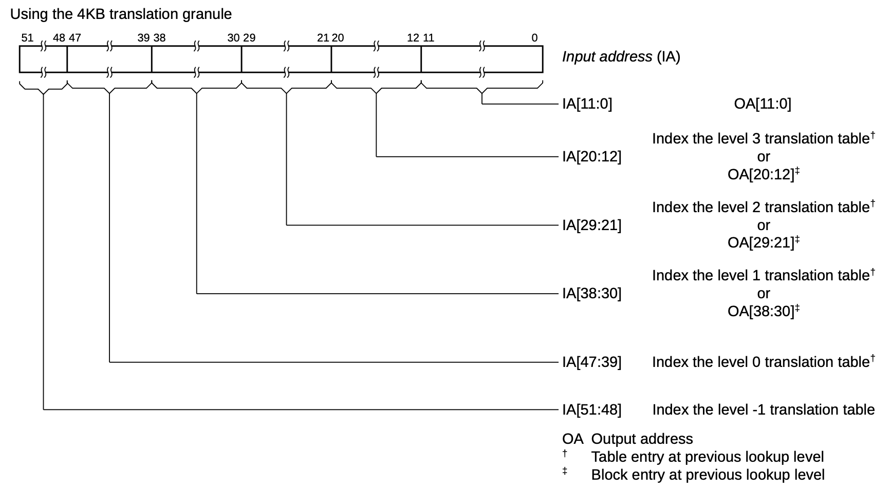
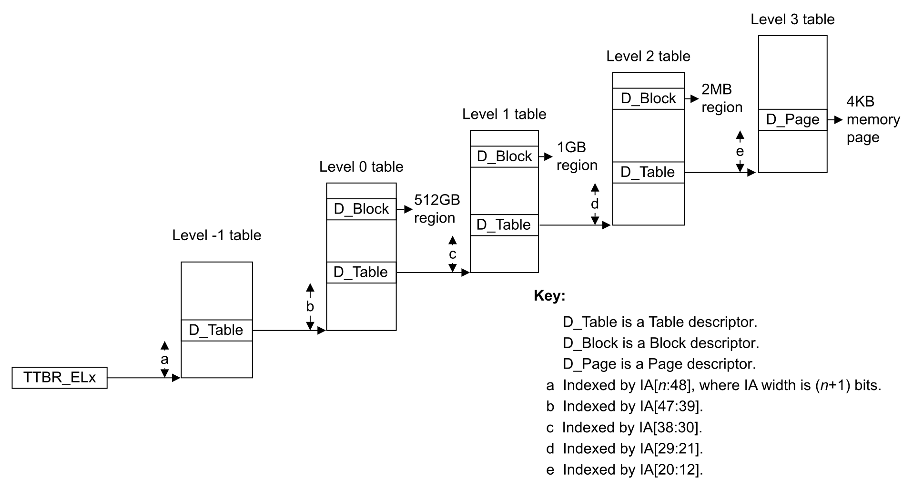

# Memory

Secular boots a Zircon kernel on `qemu-system-aarch64` (virt, arm64). The
kernel runs at EL1 with a 4 KiB, 4-level, 48-bit VMSAv8-64 stage-1 MMU. This
note is the map of that memory path: how physical RAM becomes a virtual
address space, how **user and kernel page tables** sit next to each other,
how the same physical page is visible in both, how a VA is translated, and
which registers control it.

The product stays:

```text
zircon kernel + linux-arm64-boot-shim + BOOTFS + serial console + zxsh
```

ATF → shim → physboot → `lk_main` → userboot is [`bootstrap.md`](bootstrap.md).
The linker scripts that place the load images are in that note. Exceptions
from a failed walk are [`interrupt.md`](interrupt.md). Context switch of
`TTBR0` is [`cpu.md`](cpu.md).

## Memory

### Framework

Physical RAM and MMIO on the left; two translation regimes and the
registers that walk them on the right.

```text
┌────────────┐ ┌────────────┐ ┌────────────┐ ┌────────────────────┐
│ flash      │ │ GICv3      │ │ PL011 UART │ │ DRAM               │
│ 0x00000000 │ │ 0x08000000 │ │ 0x09000000 │ │ 0x40000000         │
└────────────┘ └────────────┘ └────────────┘ └─────────┬──────────┘
       device MMIO on demand                           │ PMM
                                                       ▼
                              physmap VA = KERNEL_ASPACE_BASE + PA
                              0x40000000 → 0xffff000040000000

┌───────────────────────────────┬──────────────────────────────────┐
│ TTBR0_EL1  user  VA[55]=0     │ TTBR1_EL1  kernel  VA[55]=1      │
│ USER_ASPACE  0x200000         │ KERNEL_ASPACE  0xffff000000000000│
│ zx_vmar_map → VmMapping       │ physmap, kernel image, heap      │
│ L0 → L1 → L2 → L3  (4 KiB)    │ shared L0, ASID 1, nG=0          │
└───────────────────────────────┴──────────────────────────────────┘

  MAIR_EL1     TCR_EL1      TTBR0_EL1     TTBR1_EL1     SCTLR_EL1
  AttrIndx     T0SZ/T1SZ=16  user L0+ASID  kernel L0     M / C / I
```

### Flow

Physboot turns the MMU on; the kernel reuses those tables, then the VM
installs later maps.

```text
┌─────────────────┐
│ boot-shim       │  MMU off, DTB in x0
│ linux-arm64     │  RAM / UART / GIC → ZBI items
└────────┬────────┘
         ▼
┌─────────────────┐
│ physboot        │  MAIR + identity-map RAM/UART (TTBR0)
│                 │  SCTLR.M/C/I on
│                 │  kernel ELF at 0xffffffff00000000 (TTBR1)
│                 │  physmap + hand-off + image
└────────┬────────┘
         ▼
┌─────────────────┐
│ kernel EL1      │  arm64_mmu_early_init reads TTBR0/TTBR1
│                 │  reuse TTBR1 root, ASID 1
│                 │  PMM owns RAM; tables → vm_page_state::MMU
└────────┬────────┘
         │
    ┌────┴────┐
    ▼         ▼
 user       kernel
 zx_vmar_map   heap / MMIO / stacks
    │         │
    └────┬────┘
         ▼
┌─────────────────┐
│ ArmArchVmAspace │  Map / Query / ContextSwitch
│ ::Map           │  L0–L3 walk, tlbi, dc cvau + ic ialluis if X
└────────┬────────┘
         ▼
    hardware walk
    TTBR0 or TTBR1 → PA
```

### Physical map on QEMU virt

QEMU `virt` presents a 64-bit physical address space. Typical ranges:

| Physical range | Role |
| --- | --- |
| `0x00000000` | flash / boot ROM |
| `0x08000000` | GICv3 |
| `0x09000000` | PL011 UART |
| `0x40000000` | DRAM (default base) |

The kernel does not identity-map the whole SoC after boot. Device MMIO is
mapped only where a driver or UART path needs it. RAM is tracked by the
physical memory manager (PMM) from ZBI / DTB memory items, then published
through the kernel **physmap**.

On QEMU virt, `paddr_to_physmap(0x40000000)` is
`0xffff000040000000`: physmap virtual base plus the physical address.

### Virtual address space

ARM EL1&0 uses two translation regimes. VA bit 55 (equivalently VA[63:48]
all-zero vs all-one for a 48-bit VA) selects the root:

```text
0x0000_0000_0000_0000   unused (2 MiB low guard)
0x0000_0000_0020_0000   USER_ASPACE_BASE          TTBR0_EL1  (user)
        …  user VA, 48-bit half minus guards …
0x0000_ffff_ff00_0000   USER_ASPACE end (exclusive; 16 MiB high guard)

0xffff_0000_0000_0000   KERNEL_ASPACE_BASE        TTBR1_EL1  (kernel)
        physmap  [0, last RAM)  linearly mapped
        hand-off data
        kernel image at kHandoffVirtualAddress
        heap / first-class kernel mappings
0xffff_ffff_ffff_ffff   last kernel byte (base + 2^48 wraps in 64-bit)
```

Constants live in [`zircon/kernel/arch/arm64/include/arch/kernel_aspace.h`](../../../zircon/kernel/arch/arm64/include/arch/kernel_aspace.h):

| Symbol | Value | Meaning |
| --- | --- | --- |
| `KERNEL_ASPACE_BASE` | `0xffff000000000000` | kernel VA start; TTBR1 |
| `KERNEL_ASPACE_SIZE` | `2^48` | 256 TiB kernel half |
| `USER_ASPACE_BASE` | `0x200000` | 2 MiB low guard |
| `USER_ASPACE_SIZE` | `0xffffff000000 - 2 MiB` | user half under 48-bit VA |
| `kHandoffVirtualAddress` | `0xffffffff00000000` | kernel ELF load VA |

`is_user_accessible(va)` is “bit 55 is 0”. `is_kernel_address(va)` is “inside
`[KERNEL_ASPACE_BASE, KERNEL_ASPACE_BASE + KERNEL_ASPACE_SIZE)`”. User PCs
must be user-accessible and not in the kernel window
([`zircon/kernel/arch/arm64/include/arch/vm.h`](../../../zircon/kernel/arch/arm64/include/arch/vm.h)).

User VA also enables TBI0 (top-byte ignore): bits [63:56] are not part of
the translation. `arch_detag_ptr` strips them.

The two halves are **separate trees**, not one table with a kernel
high-half. How they share RAM is **User and kernel page tables** and
**Memory relationship**. How a load becomes a PA is **Translation
flow**.

### User and kernel page tables

EL1&0 stage-1 always has two roots. `VA[55]` picks which one the
hardware walks. There is no combined L0.

```text
                    PE  EL1 (and EL0 of the current user thread)
                              VA[55]
                     ┌──────────┴──────────┐
                     │ 0                   │ 1
                     ▼                     ▼
              TTBR0_EL1               TTBR1_EL1
              user L0                 kernel L0
              ASID ≥ 2                ASID 1, nG=0 (global)
              per process             one for the whole system
              swapped on sched        never swapped
              TCR.EPD0 = 0            always walked
                when a user thread
                is current
```

| | User (`TTBR0`) | Kernel (`TTBR1`) |
| --- | --- | --- |
| Object | one `VmAspace` per process | the kernel `VmAspace` |
| L0 page | allocated in `ArmArchVmAspace::Init` | physboot's upper root, reused |
| Who sees it | that process's threads (EL0 and EL1) | every PE, every thread |
| Context switch | `TTBR0 = ASID\|tt_phys`, `TCR` user | left alone |
| Idle / DPC / boot | `TCR.EPD0=1`: TTBR0 walks **off** | still on |
| PTE `nG` | 1 (ASID-tagged TLB) | 0 (global TLB) |
| Mapped by | `zx_vmar_map` → `VmMapping` | physmap, image, heap, MMIO, kstacks |

They do **not** share table pages. A user L3 PTE and a kernel L3 PTE
may point at the **same PA** (a VMO page that is also in the physmap).
The kernel writes user PTEs through the physmap: `tt_virt_ =
paddr_to_physmap(tt_phys_)`. EL0 may issue a kernel VA (`VA[55]=1`);
the walk uses TTBR1, then AP/UXN on the kernel PTE deny it (permission
fault, not a different root).

While a **user** thread is current, both roots are live:

```text
EL0  load [user VA]     walk TTBR0
EL0  load [kernel VA]   walk TTBR1, then AP/UXN deny
EL1  load [kernel VA]   walk TTBR1 (physmap, heap, UART)
EL1  copy_from_user     walk TTBR0 (same aspace, still this Thread)
```

`copy_from_user` does not switch tables. The syscall is the same
`Thread*`, `TTBR0` still names that process (`cpu.md`). A kernel-only
thread has `EPD0`, so a stray user VA in idle is a translation fault,
not a walk of some leftover process.

Restricted / shared aspaces (`ZX_PROCESS_SHARED`) split TTBR0 further.
The console image does not: userboot, component_manager, and `zxsh`
each have one user L0.

### Memory relationship

Physical DRAM is one pool. Virtual windows are many. PMM owns the
pages; aspaces only install PTEs.

```text
 DRAM  0x40000000…          MMIO  GIC 0x08000000  UART 0x09000000
        │ PMM                      │ mapped on demand, not in physmap
        ▼
  vm_page  (FREE / ALLOC / MMU / …)
        │
        ├──────────────────┬──────────────────┐
        ▼                  ▼                  ▼
 kernel physmap      kernel image/heap    user VMO
 VA = BASE + PA      TTBR1, not linear    VmObject pages
 TTBR1, nG=0         kstack, arena        │
                                          ▼
                                   zx_vmar_map  (per process)
                                   TTBR0, nG=1, that ASID
```

Same physical page, two (or more) VAs:

| View | VA | Table | Who |
| --- | --- | --- | --- |
| Physmap | `0xffff000000000000 + PA` | kernel L3 (or L1/L2 block) | kernel, all CPUs |
| User mapping | whatever the VMAR chose | that process's L3 | EL0 of that process; EL1 `copy_*_user` |
| Another process | a different user VA | a different TTBR0 | only that process |

The kernel does **not** put user mappings into TTBR1. It looks at user
memory either by walking TTBR0 (`copy_from_user`) or by the physmap
alias of a page it already owns (fault handler, `Map` of a VMO page).
Page-table pages themselves are PMM pages in state `MMU`; the CPU and
the kernel both reach them as `paddr_to_physmap(table_pa)`.

MMIO (GIC, UART) is a hole in the physmap span: those PAs are not RAM,
so they are not in the linear window. Drivers map them `UNCACHED_DEVICE`
in the kernel aspace only.

Console boot, one picture:

```text
PA 0x40000000…     DRAM
  kernel image     →  VA 0xffffffff00000000     TTBR1
  physmap          →  VA 0xffff000040000000     TTBR1  (same PAs)
  userboot ELF     →  some user VA              TTBR0 of "userboot"
  zxsh text/stack  →  other user VAs            TTBR0 of zxsh
  UART 0x09000000  →  a kernel device VA        TTBR1, AttrIndx 1
```

`zxsh` and userboot never see each other's TTBR0. Both see nothing of
the kernel half. The kernel sees every process's user half only while
that process's thread is current (or via an explicit aspace switch).

### Translation flow

A load, store, or fetch at `VA` on this PE:

```text
 CPU issues access at VA, current EL, read/write/execute
        │
        ▼
 TLB lookup   (ASID from TTBR0, or global if nG=0)
        │ hit: PA + attrs, apply AP/UXN/PXN vs EL → done
        ▼ miss
 VA[55]
   │ 0                    │ 1
   ▼                      ▼
 TTBR0.BADDR             TTBR1.BADDR
 (EPD0? → fault)         kernel L0
 user L0
        │
        ▼
 L0[(VA>>39)&0x1ff]  table?
 L1[(VA>>30)&0x1ff]  table or 1 GiB block?
 L2[(VA>>21)&0x1ff]  table or 2 MiB block?
 L3[(VA>>12)&0x1ff]  4 KiB page?
        │
        ├─ Valid=0 / AF=0 / AP or UXN/PXN deny
        │     → SYNC abort  (interrupt.md page fault)
        ▼
 PA = OA + VA[11:0]     (or + block offset)
 AttrIndx → MAIR_EL1    cache / device
        │
        ▼
 access the cache or the device at PA
```

Software does the same walk as `QueryLocked` (via physmap of each
table). `AT S1E0R/W` / `AT S1E1R/W` asks the MMU and reads `PAR_EL1`.

EL0 vs EL1 on the **same** PTE:

| Access | EL0 | EL1 |
| --- | --- | --- |
| User page, AP=`01` (RW/RW) | allowed | allowed (`copy_*_user`) |
| User text, UXN=0, PXN=1 | fetch ok | EL1 must not execute user |
| Kernel page, AP=`00` (RW/none) | fault | allowed |
| Kernel text, UXN=1 | EL0 cannot fetch | EL1 fetch ok |

A process switch is only a `TTBR0` (and maybe `TCR`) write
(`ArmArchVmAspace::ContextSwitch`). The walk above then starts from a
different L0. `TTBR1` and the kernel TLB entries (global) stay.

Failed walks are `ESR` instruction/data abort, `FAR` = VA. Recoverable
translation / AF / permission faults go to `vmm_page_fault_handler`
([`interrupt.md`](interrupt.md)).

### How mapping is completed

There are two phases. Physboot builds the first tables and turns the MMU on.
The kernel then takes those tables over and maps everything else through the
VM.

```text
boot-shim (MMU off)
    │  DTB in x0, RAM / UART / GIC as ZBI items
    ▼
physboot
    │  ArchSetUpAddressSpace
    │    MAIR + identity-map RAM and UART (TTBR0)
    │    enable SCTLR.M/C/I
    │  load kernel ELF at 0xffff_ffff_0000_0000 (TTBR1)
    │  map physmap, hand-off, kernel image
    ▼
kernel EL1
    │  arm64_mmu_early_init reads TTBR0/TTBR1
    │  PMM owns RAM; page-table pages become vm_page_state::MMU
    │  VmAspace + ArmArchVmAspace::Map install later mappings
    ▼
user process
       zx_vmar_map → VmMapping → ArmArchVmAspace::Map → TTBR0 walk
```

#### 1. Physboot identity map

Entry ([`zircon/kernel/arch/arm64/phys/start.S`](../../../zircon/kernel/arch/arm64/phys/start.S)) assumes caches and MMU are
off. After stacks exist, `ArchSetUpAddressSpace`
([`zircon/kernel/arch/arm64/phys/address-space.cc`](../../../zircon/kernel/arch/arm64/phys/address-space.cc)) does:

1. Program MAIR with the four attributes the kernel also uses (must stay in
   sync with `mmu.h`).
2. Allocate a lower root (TTBR0) and an upper root (TTBR1).
3. Identity-map all RAM as RWX normal memory, and the UART page as device
   memory.
4. Write MAIR, TCR, TTBR0, TTBR1; then set `SCTLR_ELx.M/C/I`.

Paging config is `4k-48bit` ([`zircon/kernel/lib/page/BUILD.gn`](../../../zircon/kernel/lib/page/BUILD.gn)). Identity
maps prefer 1 GiB, then 2 MiB, then 4 KiB blocks
(`kAddressSpacePageSizeShifts` in `phys/include/phys/address-space.h`).

#### 2. Kernel virtual map in physboot

Before jumping into `vmzircon`, physboot constructs the kernel aspace
([`zircon/kernel/phys/handoff-prep-vm.cc`](../../../zircon/kernel/phys/handoff-prep-vm.cc)):

```text
KERNEL_ASPACE_BASE + KERNEL_ASPACE_SIZE
        first-class kernel mappings          (bump up)
        hole (1 page)
        kernel memory image                  load VA 0xffffffff00000000
        hole (1 page)
        permanent hand-off data              (bump down)
        temporary hand-off data              (bump down, 1 GiB below image)
KERNEL_ASPACE_BASE + PhysmapSize()
        physmap: PA [0, last RAM) → VA [base, base + size)
KERNEL_ASPACE_BASE
```

The physmap is a linear window: `va = gPhysmapBase + pa`,
`pa = va - gPhysmapBase` ([`zircon/kernel/vm/include/vm/physmap.h`](../../../zircon/kernel/vm/include/vm/physmap.h)).
Non-RAM holes inside that span (flash, GIC, reserved firmware) are not
mapped even when they sit below `gPhysmapSize`. After this point the kernel
dereferences physical pages through the physmap: page tables themselves are
written via `paddr_to_physmap(table_paddr)`.

#### 3. Kernel takeover

`arm64_mmu_early_init` ([`zircon/kernel/arch/arm64/mmu.cc`](../../../zircon/kernel/arch/arm64/mmu.cc)) snapshots:

```text
root_lower_page_table_phys  ← TTBR0_EL1.BADDR
root_kernel_page_table_phys ← TTBR1_EL1.BADDR
```

`ArmArchVmAspace::Init` for the kernel aspace does **not** allocate a new
root. It reuses `root_kernel_page_table_phys`, ASID 1 (`MMU_ARM64_GLOBAL_ASID`).
PMM then marks physboot's table pages `vm_page_state::MMU` and stamps a
software parity bit on every PTE (`HandoffPageTablesFromPhysboot`).

Secondary CPUs ([`zircon/kernel/arch/arm64/secondary.S`](../../../zircon/kernel/arch/arm64/secondary.S)) program the same
MAIR/TCR/TTBRs, enable `SCTLR_EL1.M`, jump to the kernel virtual address,
then switch TCR to `MMU_TCR_FLAGS_KERNEL` so TTBR0 walks are disabled until
a user aspace is installed.

#### 4. Runtime maps (kernel VM)

After `vm_init`, new mappings go through the VM, not through physboot:

```text
VmObject (VMO)          pages of content (anonymous, physical, pager)
    │
VmAddressRegion (VMAR)  VA range that may contain mappings
    │
VmMapping               (vaddr, size, VMO offset, mmu flags)
    │
ArmArchVmAspace::Map    install PTEs in this aspace's tables
```

A user `zx_vmar_map` allocates a spot in the process VMAR, creates a
`VmMapping`, and on first access (or when populated) calls
`ArmArchVmAspace::Map(vaddr, phys[], count, flags)`. Kernel callers do the
same on the kernel `VmAspace` (heap, MMIO, stacks).

`Map` / `MapContiguous`:

1. Reject unaligned VA/PA, missing `PERM_READ`, or execute+uncached.
2. Translate `arch_mmu_flags_t` into PTE attributes (`MmuParamsFromFlags`).
3. If the mapping is executable, clean D-cache (physmap alias) so I-cache
   sees the new bytes.
4. Walk/allocate tables with `MapPageTable`, installing L1/L2 **blocks**
   (1 GiB / 2 MiB) when VA, PA, and size are aligned, otherwise L3 **pages**.
5. TLB maintenance through `ConsistencyManager` (`tlbi` + `dsb` + `isb`).

Unmap/protect may split a block (`SplitLargePage`). ARM requires
break-before-make when the block size changes; that is enabled only after
`LK_INIT_LEVEL_VM` so early physmap surgery can still rewrite large blocks.

Context switch (`ArmArchVmAspace::ContextSwitch`) writes:

| Incoming aspace | `TTBR0_EL1` | `TCR_EL1` |
| --- | --- | --- |
| user | `ASID << 48 \| tt_phys` | `MMU_TCR_FLAGS_USER` (TBI0, both halves) |
| kernel-only (`nullptr`) | `0` | `MMU_TCR_FLAGS_KERNEL` (`EPD0`: no TTBR0 walks) |

`TTBR1_EL1` stays the kernel root + global ASID for the life of the CPU.

### Page table establishment



Granule is 4 KiB. Each table is one page: 512 × 8-byte PTEs
(`MMU_*_PAGE_TABLE_ENTRIES = 1 << (12 - 3)`). Four levels, 9 index bits
each, 48-bit IA:

```text
VA bit:  47……39  38……30  29……21  20……12  11…………0
         L0 idx  L1 idx  L2 idx  L3 idx  page offset
         512 GB  1 GB    2 MB    4 KB
```

Index shift for level `n` is `MMU_LX_X(12, n) = (4 - n) * 9 + 3`:

| Level | `index_shift` | Descriptor if terminal | Block size |
| --- | --- | --- | --- |
| L0 | 39 | table only (no 512 GiB blocks) | — |
| L1 | 30 | block (`0b01`) or table (`0b11`) | 1 GiB |
| L2 | 21 | block or table | 2 MiB |
| L3 | 12 | page (`0b11`) | 4 KiB |



`MMU_PTE_DESCRIPTOR_BLOCK_MAX_SHIFT` is 30, so L0 never holds a block.

Kernel and user aspaces both start at L0 (`MMU_KERNEL_TOP_SHIFT` /
`MMU_USER_TOP_SHIFT` = 39) because each half is 48 bits. Guest stage-2
(hypervisor IPA) is 36-bit and starts at L1; Secular's console image does
not need it.

#### Building a tree

`ArmArchVmAspace::Init` for a **user** aspace:

1. Allocate one PMM page, zero it (`arch_zero_page` / `dc zva`), `dsb ishst`.
2. That page is the L0 root; `tt_phys_` is its PA, `tt_virt_` its physmap VA.
3. Allocate an ASID if `arm64_enable_asid` is on **and** the CPU has 16-bit
   ASIDs. 8-bit ASIDs are ignored; TLBs are flushed on every switch instead.

`MapPageTable` (recursive):

```text
at this level, for each PTE index covered by the cursor:
  if VA/PA not aligned to this block size, or remaining size too small,
     or shift > 30:
        if PTE invalid: alloc next-level table, zero it, store table descriptor
        recurse into that table
  else:
        write a block (L1/L2) or page (L3) PTE: PA | attrs | descriptor
```

A table descriptor is `next_table_pa | MMU_PTE_L012_DESCRIPTOR_TABLE`. New
tables are published with a store-release so concurrent software walkers
(`MarkAccessed`) see zeroes, not stale data. Hardware walkers are ordered
with `dsb ishst` before the parent PTE is made valid.

Kernel root is shared by every CPU. User roots are per `VmAspace`. PTEs
carry a software odd-parity bit (`MMU_PTE_RES_PARITY`, bit 56) checked on
every load; mismatch panics.

### Page table translation

End-to-end (TLB, `VA[55]`, EL0 vs EL1 permissions) is **Translation
flow**. This subsection is the table walk itself.

Hardware walk (EL1&0 stage 1), matching `QueryLocked`:

```text
if VA[55] == 0:  root = TTBR0_EL1.BADDR,  va' = VA            # user
else:            root = TTBR1_EL1.BADDR,  va' = VA - vaddr_base  # kernel
                                                 # vaddr_base = 0xffff000000000000

table = root
for shift in 39, 30, 21, 12:
    index = (va' >> shift) & 0x1ff
    pte   = table[index]
    if pte.Valid == 0:  fault
    if pte is block (L1/L2) or page (L3):
        PA = pte.OA + (VA & (block_size - 1))
        apply AP / UXN / PXN / AttrIndx; done
    table = physmap(pte.OA)          # next-level table
```

`ArmArchVmAspace::Query` is that walk in software. `arm64_mmu_translate`
asks the CPU instead:

```text
AT S1E0R/W, va     # user read/write
AT S1E1R/W, va     # kernel read/write
ISB
PAR_EL1            # bit 0 = fault; PA in bits [51:12]
```

TLB: successful walks cache in the TLB tagged by ASID (user) or as global
(kernel, `nG=0`). After a PTE change the consistency manager issues
`TLBI VAE1IS` / `VALE1IS` (user+ASID), `VAAE1IS` / `VAALE1IS` (all ASIDs),
or `VMALLE1IS` (whole EL1), then `DSB ISH` and `ISB`.

A translation fault becomes a synchronous exception: `ESR_EL1` class
`IABT`/`DABT`, `FAR_EL1` holds the VA. The VM fault path looks up the
`VmMapping`, may demand-page the VMO, then `Map`s the page and retries.

### PTE bits

64-bit descriptor ([`zircon/kernel/arch/arm64/include/arch/arm64/mmu.h`](../../../zircon/kernel/arch/arm64/include/arch/arm64/mmu.h)):

| Bits | Field | Role |
| --- | --- | --- |
| [0] | Valid | 0 = invalid (must be the whole PTE 0 here) |
| [1:0] | Descriptor | L0–L2: `01` block, `11` table; L3: `11` page |
| [4:2] | AttrIndx | MAIR index 0–3 |
| [5] | NS | non-secure |
| [7:6] | AP | EL1/EL0 read-write vs read-only |
| [9:8] | SH | shareability (inner shareable for RAM) |
| [10] | AF | access flag; kernel sets it on new maps |
| [11] | nG | not-global; user pages, ASID-tagged |
| [47:12] | OA | output address (PA or next table) |
| [52] | Contiguous | hint for 16-entry blocks |
| [53] | PXN | privileged execute never |
| [54] | UXN | unprivileged execute never |
| [55] | sw AF | software accessed bit on **table** entries |
| [56] | parity | software odd parity |

Stage-1 AP encodings used here:

| AP | EL1 | EL0 |
| --- | --- | --- |
| `00` | RW | none | kernel data |
| `10` | RO | none | kernel RO / text after lockdown |
| `01` | RW | RW | user writable |
| `11` | RO | RO | user readable / executable |

Kernel text is `UXN` (user cannot execute kernel). User text is `PXN` (EL1
cannot execute user).

MAIR_EL1 indices (physboot and kernel must match):

| Index | MAIR byte | Used as |
| --- | --- | --- |
| 0 | `0x00` | Device-nGnRnE (strongly ordered) |
| 1 | `0x04` | Device-nGnRE (MMIO) |
| 2 | `0xff` | Normal Write-Back R/W allocate |
| 3 | `0x44` | Normal non-cacheable (write combining) |

`arch_mmu_flags_t` in `vm/arch_vm_aspace.h` is the portable view:
`CACHED` / `UNCACHED` / `UNCACHED_DEVICE` / `WRITE_COMBINING` plus
`PERM_{USER,READ,WRITE,EXECUTE}`.

### Basic registers

#### General-purpose (AArch64)

| Register | Role |
| --- | --- |
| `x0`–`x7` | arguments / return; `x0` is the DTB or ZBI pointer at `_start` |
| `x8`–`x15` | caller-saved temporaries |
| `x16`, `x17` | intra-procedure-call (`ip0`/`ip1`) |
| `x18` | platform register; not a free temp |
| `x19`–`x28` | callee-saved |
| `x29` | frame pointer; phys `_start` zeros it |
| `x30` | link register (`lr`) |
| `sp` | stack; `SPSel` chooses `SP_EL0` vs `SP_ELx` |
| `pc` | not a named GPR; return uses `ret` / `eret` |

Exception entry saves an `iframe_t` (`arch/regs.h`): `x0`–`x29`, `ELR_EL1`,
`SPSR_EL1`, `x30`, user `SP`. That is the state `zxsh` / crash logs dump.

#### Exception model

| EL | Who | Translation |
| --- | --- | --- |
| EL0 | user (`zxsh`, userboot, component_manager) | TTBR0, TCR T0SZ |
| EL1 | Zircon kernel | TTBR1 + current TTBR0 |
| EL2 | QEMU ATF / optional hypervisor | physboot may start here; drops to EL1 |

`DAIF` masks Debug / SError / IRQ / FIQ. `_start` sets all four. `VBAR_EL1`
is the kernel vector table; phys `_start` zeros it until the kernel installs
its own.

#### MMU control (EL1)

These are the registers that complete a mapping. Physboot writes them in
`EnablePagingForEl`; the kernel keeps the same layout.

**`MAIR_EL1`** — eight 8-bit memory types. Secular uses indices 0–3 as in
the table above. A PTE's `AttrIndx` selects one byte.

**`TCR_EL1`** — how to walk TTBR0 (low half) and TTBR1 (high half):

| Field | Kernel value | Meaning |
| --- | --- | --- |
| `T0SZ` / `T1SZ` | `64 - 48 = 16` | 48-bit VA in each half |
| `TG0` / `TG1` | 4 KiB granule | user TG0=0, kernel TG1=2 |
| `IRGN` / `ORGN` | write-back allocate | cacheable table walks |
| `SH0` / `SH1` | inner shareable | SMP-visible tables |
| `IPS` | 40-bit default (`MMU_TCR_IPS(2)`) | max output PA; physboot may program the CPU's `PARange` (capped at 48) |
| `AS` | 1 | ASID is 16 bits when the CPU has them |
| `A1` | 1 when kernel-only | ASID lives in TTBR1 |
| `EPD0` | 1 in `MMU_TCR_FLAGS_KERNEL` | disable TTBR0 walks |
| `TBI0` | 1 for user | ignore VA[63:56] |

**`TTBR0_EL1`** — user L0 table. Format: `ASID[63:48] \| BADDR[47:1]`.
ASID 0 is unused; user ASIDs start at 2.

**`TTBR1_EL1`** — kernel L0 table. Always ASID 1 (global). Secondary CPU
bring-up ORs `(0x1 << 48)` onto `root_kernel_page_table_phys`.

**`SCTLR_EL1`** — system control. Bits that finish enabling translation:

| Bit | Name | Effect |
| --- | --- | --- |
| 0 | `M` | MMU on |
| 2 | `C` | data cache enable (D-cache only useful with `M`) |
| 12 | `I` | instruction cache enable |

Physboot requires `M` and `C` clear before programming TCR/TTBR, invalidates
I-cache and TLBs, then sets `M|C|I` and `ISB`.

**`PAR_EL1`** — result of `AT`. Bit 0 set means the walk failed; otherwise
PA is bits [51:12] plus the page offset from the VA.

**`FAR_EL1` / `ESR_EL1`** — fault address and syndrome for aborted walks
(permission, translation, access-flag, alignment).

**`TPIDR_EL1`** — kernel thread pointer. Phys `_start` points it at
`boot_thread_pointer` before C++ runs.

**`SPSel`** — `1` selects `SP_ELx`. Phys `_start` sets this before loading
`sp`, so the boot stack is the EL1 stack, not `SP_EL0`.

#### Turn-on sequence (one CPU)

The order is required; a wrong store leaves the CPU fetching through a
half-built table.

```text
I-cache / TLB invalidate
DSB + ISB
MAIR_EL1  ← MMU_MAIR_VAL
TCR_EL1   ← T0SZ/T1SZ, TG, cacheable walks, IPS
ISB
TTBR0_EL1 ← lower root   (identity or user)
TTBR1_EL1 ← kernel root | (ASID 1 << 48)
ISB
SCTLR_EL1.M/C/I ← 1
ISB
jump to kernel VA          # secondary.S: br kernel_vaddr
TCR_EL1 ← EPD0             # drop identity TTBR0 once running at high VA
```

### Where in the tree

| Path | Why |
| --- | --- |
| [`zircon/kernel/arch/arm64/include/arch/kernel_aspace.h`](../../../zircon/kernel/arch/arm64/include/arch/kernel_aspace.h) | user/kernel VA windows |
| [`zircon/kernel/arch/arm64/include/arch/arm64/mmu.h`](../../../zircon/kernel/arch/arm64/include/arch/arm64/mmu.h) | TCR, MAIR, PTE, ASID, `EPD0` |
| [`zircon/kernel/arch/arm64/include/arch/vm.h`](../../../zircon/kernel/arch/arm64/include/arch/vm.h) | `is_user_accessible` / TBI |
| [`zircon/kernel/arch/arm64/include/arch/regs.h`](../../../zircon/kernel/arch/arm64/include/arch/regs.h) | exception `iframe_t` |
| [`zircon/kernel/arch/arm64/phys/start.S`](../../../zircon/kernel/arch/arm64/phys/start.S) | MMU-off entry, stacks, `TPIDR_EL1` |
| [`zircon/kernel/arch/arm64/phys/address-space.cc`](../../../zircon/kernel/arch/arm64/phys/address-space.cc) | MAIR/TCR/TTBR/SCTLR enable |
| [`zircon/kernel/phys/address-space.cc`](../../../zircon/kernel/phys/address-space.cc) | identity-map RAM + UART |
| [`zircon/kernel/phys/handoff-prep-vm.cc`](../../../zircon/kernel/phys/handoff-prep-vm.cc) | physmap + kernel image layout |
| [`zircon/kernel/arch/arm64/mmu.cc`](../../../zircon/kernel/arch/arm64/mmu.cc) | `Map`/`Query`/`ContextSwitch`/`AT` |
| [`zircon/kernel/arch/arm64/secondary.S`](../../../zircon/kernel/arch/arm64/secondary.S) | AP MMU turn-on |
| [`zircon/kernel/vm/include/vm/physmap.h`](../../../zircon/kernel/vm/include/vm/physmap.h) | `paddr_to_physmap` |
| [`zircon/kernel/vm/vm_aspace.cc`](../../../zircon/kernel/vm/vm_aspace.cc) | `VmAspace` / kernel aspace init |
| [`zircon/kernel/object/include/object/shareable_process_state.h`](../../../zircon/kernel/object/include/object/shareable_process_state.h) | process aspace + handle table |
| [`zircon/kernel/lib/page/BUILD.gn`](../../../zircon/kernel/lib/page/BUILD.gn) | `4k-48bit` paging config |

### Terminology

| Term | Meaning in this note |
| --- | --- |
| VA | Virtual address. Bit 55 selects TTBR0 (0, user) vs TTBR1 (1, kernel). |
| PA | Physical address. DRAM on QEMU virt starts at `0x40000000`. |
| TTBR0_EL1 | User page-table base + ASID. One L0 per process. Swapped on thread switch. |
| TTBR1_EL1 | Kernel page-table base + global ASID 1. One L0 for the system. Never swapped. |
| L0…L3 | Four page-table levels, 512 × 8-byte PTEs each, 4 KiB granule. |
| PTE | Page table entry. Block (L1/L2) or page (L3) or table pointer. |
| Physmap | Linear kernel window: `VA = KERNEL_ASPACE_BASE + PA`. How the kernel touches RAM and table pages. |
| PMM | Physical memory manager. Owns DRAM pages; aspaces only install PTEs. |
| VMO | Virtual Memory Object. Content (anonymous, physical, pager). Mapped into a VMAR. |
| VMAR | Virtual Memory Address Region. A VA range in an aspace; `zx_vmar_map` creates a `VmMapping` in it. |
| ASID | Address Space ID in `TTBR0[63:48]`. Tags user TLB entries. Kernel PTEs are global (`nG=0`). |
| `nG` | Not-global PTE bit. User pages 1; kernel pages 0. |
| `EPD0` | TCR bit: disable TTBR0 walks. Set for kernel-only threads (idle, DPC). |
| TBI0 | Top-byte ignore on user VAs. Bits [63:56] are not translated. |
| AP / UXN / PXN | PTE permission: EL1 vs EL0 read/write; user-execute-never; privileged-execute-never. |
| AttrIndx | PTE index into `MAIR_EL1` (device vs Normal Write-Back). |
| Stage-1 | EL1&0 translation (this product). Stage-2 is guest IPA; not on the console path. |
| `AT` / `PAR_EL1` | Address-translate instruction and its result register. Software probe of the same walk. |

---

Everyday's a Hustle.
