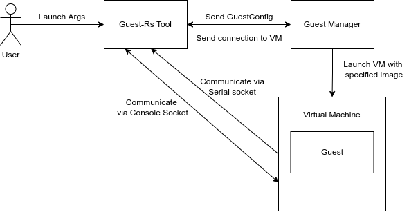
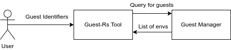
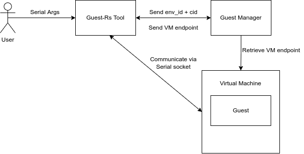
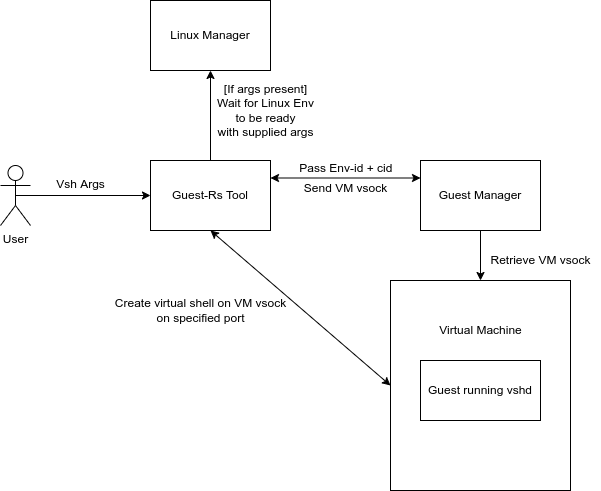

# Fuchsia Guest Tool
Welcome to the Fuchsia Virtualization Guest tool. This document covers the basic structure of how
our command-line interface (CLI) tool works, so that you can make full use of it and extend it to
fit your needs!

## Commands and Usage
### Launch
The `launch` command creates an interactive session with a new Virtual Machine running the
specified package.

#### Arguments
`guest launch vmid=0 [--cmdline-add <arg>...] [--memory <memory-size>] [--cpus <num-cpus>] [--virtio-* <bool>]`

**Example**: `guest launch vmid=0 --memory 536870912 --cpus 2`

**Positional Arguments**
- `vmid`: Guest identifier, written as `vmid=<id>` or a bare integer. Each
   vmid is a distinct guest instance served by the unified
   `fuchsia.virtualization.GuestManager`.

**Optional Arguments**
- `cmdline-add: String`: Argument to add to the Guest kernel command line.
    This option is repeatable to add multiple arguments.
- `memory: u64`: Amount of memory, in bytes, to provide the Guest.
- `cpus: u8`: Number of virtual cpu's provided to the Guest.
- `virtio-balloon: bool`: Whether to enable `virtio-balloon` for the Guest.
- `virtio-console: bool`: Whether to enable `virtio-console` for the Guest.
- `virtio-rng: bool`: Whether to enable `virtio-rng` for the Guest.
- `virtio-vsock: bool`: Whether to enable `virtio-vsock` for the Guest.

#### Structure
The `launch` command serves as an intermediary between the end user and the Guest Manager.
The end user provides the specified arguments (shown above) for how they wish the Guest to be
configured, which are parsed by the `guest` tool. The parsed arguments and then sent to the
Guest Manager via FIDL, which spawns a vmm (Virtual Machine Monitor) component and supplies a FIDL
connection to the `guest` tool for communicating with the spawned Guest.

The Virtual Machine (VM) is communicated with to retrieve sockets connected to the Guest's serial
port and terminal. These sockets are treated as data streams within `guest`, processing
information read from these sockets and writing user input back to the VM (which then passes the
information to the Guest), enabling an interactive session to occur.




### Stop
`guest stop vmid=0 [-f]`

Stops the guest identified by vmid. `-f` force-stops without a graceful
shutdown command.

### Attach
`guest attach vmid=0`

Attaches console and serial to a running guest identified by vmid.

### List
The `list` command shows guests that have been launched, or details for one vmid.

#### Arguments
`guest list`

`guest list vmid=0`

**Example summary**:
```
VMID     Status   Uptime
vmid=0   Running  00:02:03 HH:MM:SS
```

**Example details** (`guest list vmid=0`):
```
Guest vmid:         vmid=0
Guest package:      fuchsia-boot:///guest_manager#meta/guest_pkg.cm
Guest status:       Running
Guest uptime:       00:02:03 HH:MM:SS
Kernel type:        Rtos
CPU count:          2
Guest memory:       72 MiB (75497472 bytes)
Active devices:     console
Inactive devices:   rng
                    balloon
                    vsock
                    gpu
                    sound
                    mem
Networks:           None
```

Details include kernel type, command line, CPU and memory, virtio devices, and
network interfaces. Stopped guests also report the stop reason and the last
launch configuration.

#### Structure
The `list` command connects to the Guest Manager via FIDL and queries guests by
vmid. Use `guest list` for a summary, or `guest list vmid=0` for details of one
guest. The vmid values are used as arguments for other commands.



### Serial
The `serial` command allows for interacting with a Guest over a serial connection.

#### Arguments
`guest attach vmid=0`

**Example**: `guest attach vmid=0`

**Positional Arguments**
- `vmid`: Guest identifier, for example `vmid=0`. See `list` for how to find this value.

#### Structure
The `serial` command provides a convenient way to interact with a VM through a serial connection.
This is useful for when you wish to access the serial port for a running VM, for example.
The `guest` tool takes an environment identifier and a context identifier that identifies a VM,
which are provided to the Guest Manager. Upon successful location, the `guest` tool is provided
with a FIDL connection to the VM, which is then queried for a serial socket. The `guest` tool
takes this socket and begins an interactive session over serial only, similar to the process in `launch`.



### Vsh (Virtual Shell)

The `vsh` command allows for creating a virtual shell to a termina guest.

#### Arguments
`guest vsh [--port <port>] [-c] [--] [<args...>]`

**Example**: `guest vsh echo hello world`
**Example**: `guest vsh -- uname -a`

**Optional Arguments**
- `--port: u32`: Port that vshd is listening on.
- `-c | --container`: Connect to the debian container directly.

**Positional Arguments**
- `args: Vec<String>`: Positional arguments are forwarded as the argv for remote execution.
    Leave blank for default login shell.

#### Structure

_**It is important to note** that this command requires a `vshd` server is run in the Guest prior_
_to use, which as of writing is currently only true for `termina`._

The `vsh` command is the primary way of interacting with termina guests via a remote shell.
The end user provides `guest` with optional values for the port that identifies the vsock connection
for `vsh` to create a new virtual shell on (defaults to 9001 if no port given), and whether to
connect to the outer VM (the default) or the inner container.

The positional arguments are used as argv for some executable to run in the guest. Note that `--`
can be used to disambiguate the guest's command line flags from vsh's own.

If termina is not already launched vsh will attempt to launch it, printing out its progress to the
terminal. If no args are supplied the user will be taken to the default login shell of the VM or the
container (if `-c` was specified).

On failure to start termina the user is prompted if they would like to try again (failure may occur
for a few reasons, most notably internet connection issues).



### Wipe

The `wipe` command allows for clearing any stateful data associated with the guest. Currently
this command only supports termina.

The VM must not already be running when this command is issued.

#### Arguments

**Example**: `guest wipe vmid=0`

**Positional Arguments**
- `vmid`: The guest to clear.
